# fourSwordsFromThePast

<p align="center"></p>

*The Legend of Zelda: A Link to the Past* as a native PC game with **four player
drop-in/drop-out co-op** (same PC, LAN and internet), each Link in its own
color, free roaming (split screen when couch players go separate ways), a
camera that keeps the group in view, per-player hearts and magic, menus that
don't pause co-op, a mini map,
lifting and throwing teammates (over pits),
lifting heavy rocks together, hookshotting to a teammate, floor switches
any Link can hold down, arrows pointing to teammates off screen, ping
markers ("look here" and "help"), room codes instead of IP addresses, a seat
that waits two minutes for a player whose connection dropped, a player list
with ping and location, keeping a copy of the host's game, each player's Y
item and name in their corner, per-player rumble, a team panel in the
spare quarter of a three-way split screen,
private item menus and maps, rollback netcode, spectating while you're down
(and sending teammates hearts), name tags, color-blind friendly colors,
rumble, toggleable friendly fire, native widescreen, an optional 2D-HD look,
a 3D view with first person (beta), an in-game options menu, a built-in item randomizer and
[Archipelago](https://archipelago.gg) multiworld support.

Built on the [snesrev/zelda3](https://github.com/snesrev/zelda3) C
reimplementation (vendored from commit `45a149d8`, MIT licensed). You need your
own US ROM to extract the game's assets.

**Community:** join the fourSwordsFromThePast Discord at
https://discord.gg/jEsJGwhyNS for this mod (co-op, netplay, the randomizer,
2D-HD). Questions about the underlying zelda3 engine itself go to snesrev's
server, linked in the upstream section below.

<p align="center">
  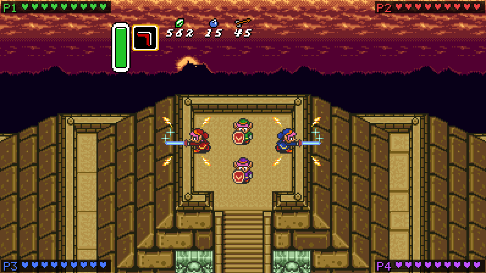
  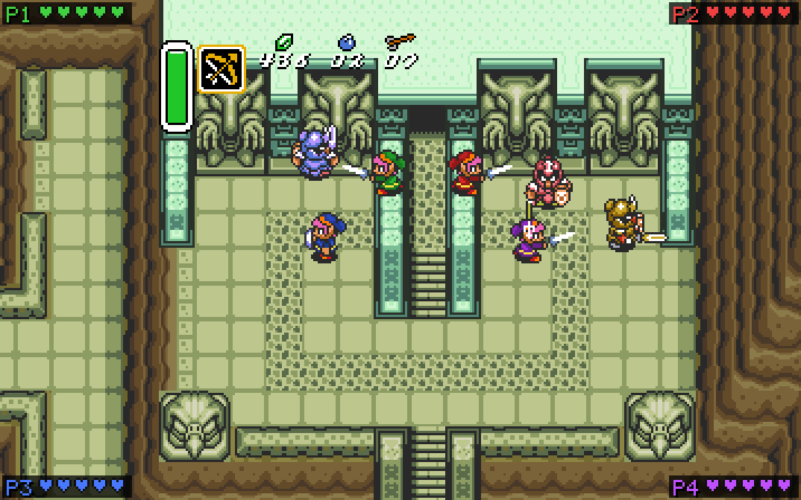
</p>
<p align="center">
  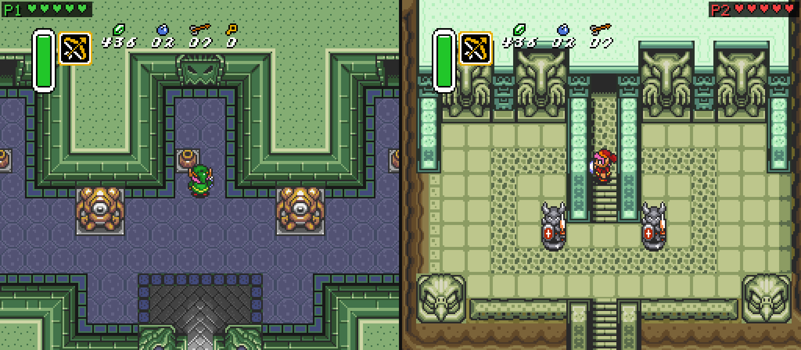
  
</p>

<p align="center">
  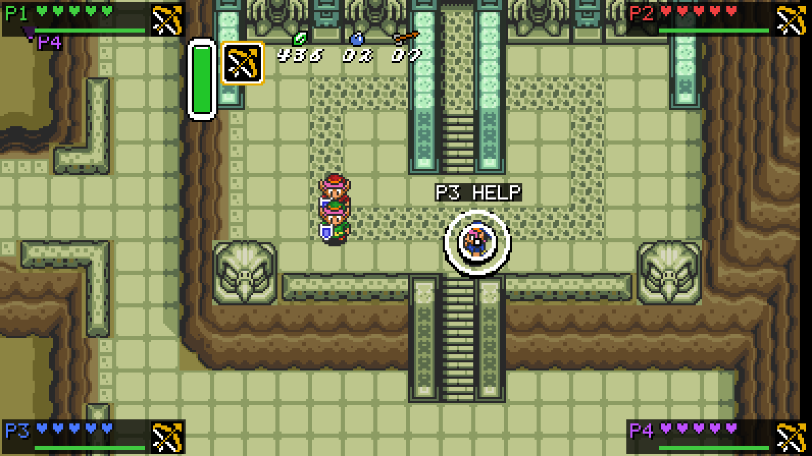
  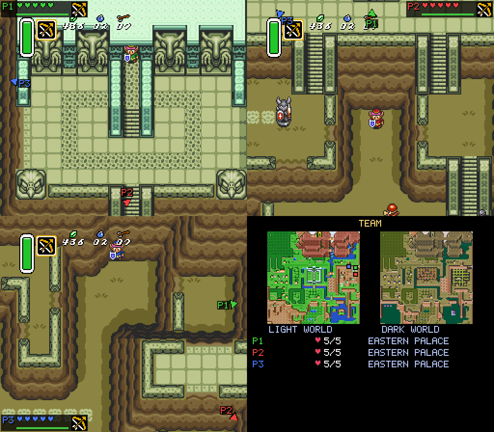
</p>

*Four Links in widescreen on the Pyramid of Power and at the Eastern Palace;
free roaming with split screen; the retold opening legend; carrying a
teammate, a ping for help and an arrow to a teammate elsewhere; three players
in three places with the team panel.*

See **[MULTIPLAYER.md](MULTIPLAYER.md)** for how co-op and netplay work.
See **[docs/HOW_THE_MOD_WORKS.md](docs/HOW_THE_MOD_WORKS.md)** for a plain-language guide to how the whole mod works.

## Four Swords of the Past

The title screen says **Four Swords of the Past**, and the legend that plays
after it is retold: long ago the seven wise men hid the Golden Power and,
beside it, the Four Sword, a blade that splits one hero into four. When the
thief Ganon seized the Golden Power, a young knight drew the Four Sword,
became four heroes in green, red, blue and purple, and sealed Ganon away. Ages
later Agahnim comes to break the seal, and the Four Sword stirs again, calling
for four heroes.

Both can be turned off in *Pause menu > Gameplay* (`FourSwordsStory` and
`FourSwordsTitle` in `zelda3.ini`). Online, the host's story setting is used.
The story is written in English, so with another `Language` the original text
plays.

## Item randomizer

*Pause menu > Gameplay > Randomize new games* turns on a basic item
randomizer for save files created from then on (or set `Randomizer` in the
`[Features]` section of `zelda3.ini`).

- **Open start, no tutorial.** A randomized file skips the intro and the
  escape from Hyrule Castle: it starts as if Zelda was just brought to the
  sanctuary. Link has full magic, starts at his house or the sanctuary, and
  can go anywhere from the first step:
  no rain, no guards blocking the way, no need to rescue Zelda (so no Lamp
  needed to get started). Randomized files made with an older build get the
  open start when loaded. Non-randomized files start the usual way.
- The contents of every chest in the game are shuffled: Bow, Hookshot,
  Hammer, gloves, Moon Pearl, Fire and Ice Rods, Lamp, Cane of Somaria,
  Magic Cape, Cane of Byrna, mails, Mirror Shield, boomerangs, a bottle,
  heart pieces, rupees, bombs and arrows. Small keys, big keys, maps and
  compasses stay in their dungeons, so dungeons play as before.
- **Swords and shields are randomized too.** Link starts with nothing. The
  uncle waits in the secret passage next to the castle (through the hole
  under the bush, like in the original) and gives the two random items the
  seed put there instead of his sword and shield. The Master Sword pedestal, the smiths, the Pyramid fairy (throw any sword in)
  and the Waterfall of Wishing fairy (throw any shield in) each give a
  random item once, and you get back what you threw in or handed over. The
  four swords and three shields can be anywhere, also in chests, and are
  progressive: each sword found is the next level (fighter's, Master,
  tempered, golden), and so is each shield. You may start without a sword;
  the logic makes sure you find one before you need it.
- Other items given by people or found outside chests (Boots, Book,
  Flippers, Mirror, Flute, medallions, pendants and crystals)
  are where they always were.
- Every seed is checked to be beatable without glitches, starting from the
  open start. One Lamp is always in Link's house or the sanctuary chest.
  The castle basement and sewer chests (normally opened during the escape)
  only get filler. Dungeons count as needing a sword, and the medallion
  tablets and Agahnim's tower barrier the Master Sword level (or the cape).
  Gloves, mails and boomerangs are progressive too: the first glove found
  is the Power Glove, the second the Titan's Mitt.
- The seed is stored in the save file, so a file stays randomized the same
  way. *Gameplay > This game* shows the seed; choosing "on, seed ..." makes
  new files with that same seed, to race a friend or replay it. (A new file
  always gets the newest placement of its seed, while a file made with an
  older build keeps the one it had: to race on a seed, use the same build.)
  *Gameplay > Enter a seed* takes a friend's 8-digit seed (type it, or
  change each digit with Left/Right), and the file select screen shows the
  seed new files will get. *Gameplay > Write spoiler log* writes
  `spoiler_<seed>.txt`: where the important items are, in the order they
  can be collected, and every location.
- In netplay the host's setting is used, and everybody plays the same seed.
- `src/randomizer.c` has the location logic. `./zelda3 --mptest` with
  `randocheck <first seed> <count> [verbose]` checks seeds and prints spoilers.

## Full inventory (for testing)

*Pause menu > Gameplay > Start new games with all items* (or
`FullInventory = 1` in the `[Features]` section of `zelda3.ini`) gives save
files created from then on every item at its best: the bow with silver
arrows, the magical boomerang, all rods, canes and medallions, the flute
(instead of the shovel), the powder (instead of the mushroom), the Titan's
Mitt, the golden sword, the mirror shield and the red mail, 20 full hearts,
full magic at half the cost, four bottles (a fairy, a blue and a red potion
and an empty one), and the most bombs, arrows and rupees. Pendants, crystals and
dungeon keys, maps and compasses are left alone.

- Such a file starts open, like a randomized one (no intro, no castle
  escape): the sword wouldn't swing before the uncle is met, and with a
  better sword than his Zelda isn't in her cell. In a file that isn't
  randomized the uncle is gone too, since he'd only hand over his sword and
  shield; in a randomized one he still waits in the passage with the seed's
  two items.
- Nothing found later takes an item down a level (the Master Sword, the
  Bow's chest, the Power Glove, the shovel, ...). Files made without the
  option work exactly as in the original game.
- It combines with the randomizer, and the file select screen says when new
  files will get it. In netplay the host's setting is used.

## Archipelago (multiworld randomizer)

[Archipelago](https://archipelago.gg) links randomizers of many games into
one *multiworld*: your chests can hold another player's items (in their own
game, maybe a different one) and theirs can hold yours. This game has its
own Archipelago world, **Four Swords of the Past**, and connects to an
Archipelago server by itself (no extra client program).

<p align="center">
  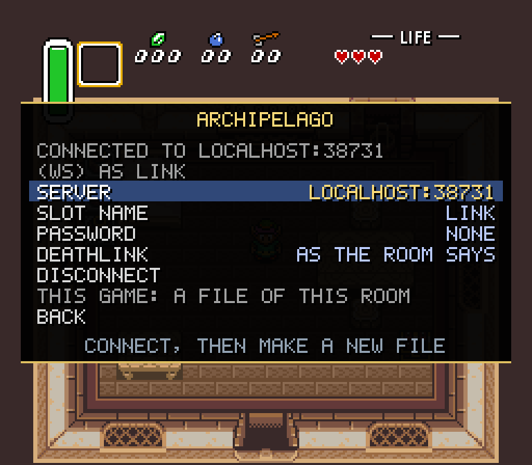
  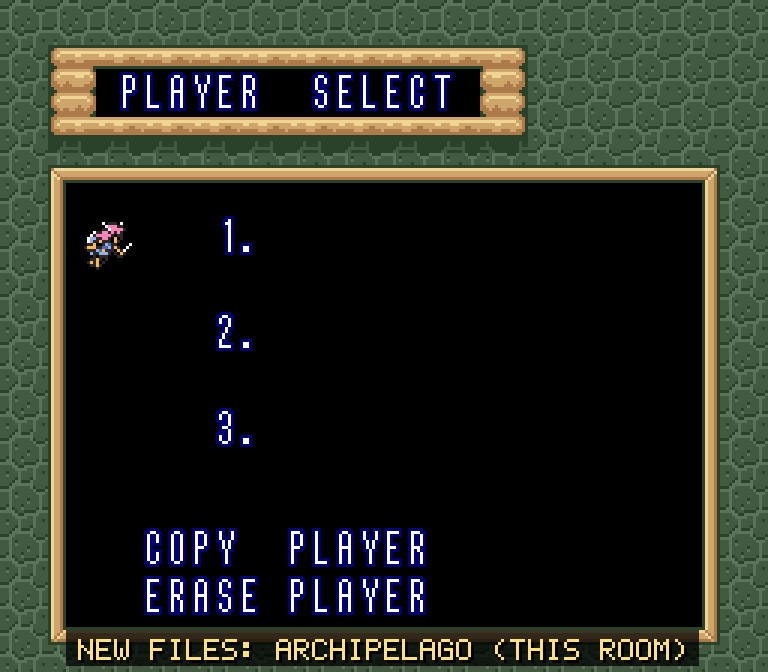
</p>
<p align="center">
  
  
</p>

*Connected to a room from the menu, new files become files of that room.
The chest in Link's house held Marin's Bow, so Link gets the white crystal
and the Bow goes to Marin; the Cane of Somaria in Marin's game was Link's,
and arrives a moment later. (Two players on a local Archipelago server.)*

<details open>
<summary><b>Step by step</b></summary>

Good to know first: the folders named below (`Players`, `custom_worlds`,
`output`) are in your Archipelago install (*Browse Files* in the Launcher).
Typing the address and slot name in the game needs a keyboard (plain letters,
digits, spaces and symbols); on a controller-only device put them in the
`[Archipelago]` section of `zelda3.coop.ini` if that file exists, otherwise
of `zelda3.ini` (see *Settings file*). The game has no chat: for hints
(`!hint`) and the room's other commands, connect Archipelago's *Text Client*
to the same room with your slot name.

**What you need**

- This game, set up as described under [Quick start](#quick-start-linux--macos)
  or [Windows](#windows).
- On the computer that makes the multiworld: [Archipelago](https://github.com/ArchipelagoMW/Archipelago/releases)
  0.6.4 or newer (the Launcher), and `fsotp.apworld`, the Archipelago world
  for this game. It comes with the game's download (next to `zelda3.ini`), or
  build it from these sources
  with `python3 archipelago/build_apworld.py` (only needs Python 3; it writes
  `archipelago/fsotp.apworld`). Players of other games don't need it.

**1. Install the world.** Double-click `fsotp.apworld` (the Launcher opens
and installs it), or use *Install APWorld* in the Launcher, or copy the file
into the `custom_worlds` folder of your Archipelago install. Restart the
Launcher.

**2. Make your YAML** (your options). Copy `Four Swords of the Past.yaml`
(next to `zelda3.ini` in the game's download; in the sources it is
[`archipelago/Four Swords of the Past.yaml`](archipelago/Four%20Swords%20of%20the%20Past.yaml))
(or use *Generate Template Options* in the Launcher and take the file from
`Players/Templates`) and set:

- `name`: your slot name, at most 16 characters. You type it into the game
  later, exactly (capitals count).
- `death_link`: `true` or `false` (see DeathLink below).
- `goal`: `ganon` (the only goal for now), and if you like the options every
  Archipelago game has: `progression_balancing`, `accessibility`,
  `local_items`, `start_inventory`, ...

A co-op team is **one** player in the multiworld: one YAML for the whole
team.

**3. Generate the multiworld on your computer.** The archipelago.gg website
can only generate games that are part of Archipelago itself, so this step
happens locally (everything else can still be on the website):

1. Put everyone's YAML files (all games) into the `Players` folder of your
   Archipelago install.
2. In the Launcher, click *Generate*. The multiworld is written to the
   `output` folder as `AP_<number>.zip`.

**4. Host it.** Either:

- **On archipelago.gg:** open [archipelago.gg/uploads](https://archipelago.gg/uploads),
  upload the `AP_<number>.zip`, and click *Create New Room*. The room page
  shows the address to connect to, like `archipelago.gg:38281` (the port is
  different for every room). Share the room page with the others. An idle
  room goes to sleep: opening its page wakes it up.
- **On your own computer:** click *Host* in the Launcher and pick the zip.
  The others connect to your address on port 38281 (over the internet:
  forward TCP port 38281 on your router).

**5. Connect from the game.**

1. Start the game and open the menu: `Esc`, or Back+Start on a controller.
2. Go to *Multiplayer > Archipelago*.
3. *Server*: the room's address, e.g. `archipelago.gg:38281` (type it, or
   paste it with Ctrl+V; the room page's whole `/connect archipelago.gg:38281`
   line works too). *Slot name*: as in your YAML. *Password*: only if
   the room has one. (The menu shows everything in capitals; what you type
   keeps its case.)
4. Choose *Connect*. The status at the top of the screen changes to
   "Connected to <address> (ws or wss) as <slot>", and *Connect* becomes
   *Disconnect*.
5. **Make a new save file.** While connected, new files are Archipelago files
   of that room; the file select screen says "New files: Archipelago (this
   room)". (Connect from the file select screen, or save and quit first. Turn
   *Gameplay options > Start new games with all items* off, or the file
   starts with every item.)

To play on another day: connect to the same room first, then load the same
file. A file remembers its room: loaded while connected to another one, it
neither gets items nor sends anything (the game says so). You can also play
an Archipelago file without a connection; what you check is kept in the save
and sent when you connect again, and your items arrive then.

</details>

**How it plays**

- An Archipelago file is randomized by the multiworld, with the open start of
  the [item randomizer](#item-randomizer): Link starts at his house with
  nothing and can go anywhere. Swords, shields, gloves, mails and boomerangs
  are progressive.
- There are 106 locations: the 100 chests that don't hold dungeon keys, maps
  or compasses, the two items of Link's uncle in the secret passage, the
  Master Sword pedestal, the smiths, and the fairies of the Pyramid and the
  Waterfall of Wishing. Each hands out a white crystal, the **Archipelago
  item**: the server says what it was, and a line at the bottom of the screen
  tells you ("Sent Hookshot to Alice", "Found your own Lamp"). Lines in
  purple are items someone needs, blue useful ones, red traps and problems.
- **Your items** (also the ones found in your own game) come from the server
  and are held up like from a chest, one at a time, as soon as a Link is
  free: standing on the ground, not in a menu, a text box or a transition. A
  swimming Link or a bunny waits until it is on land again in its own shape.
- Small keys, big keys, maps and compasses stay in their dungeons, and
  everything that isn't in a chest or one of the places above stays where it
  always is: the Boots, Book, Flippers, Mirror, shovel, Flute, medallions,
  pendants and crystals, but also free heart pieces, boss heart containers
  and what people give you. The logic is the item randomizer's, without
  glitches.
- **Goal:** beat Ganon. Reaching the Triforce room tells the server you are
  done.

**Co-op.** The whole team is one slot and shares one inventory. Couch players
just join as usual. Online, **only the host connects** to the Archipelago
room (on the others' computers the Archipelago screen says so): the items
reach every computer in the same frame, and what any Link checks counts for
the team. An item goes to the first player (P1, then P2, ...) who is free to
hold it up.

**DeathLink.** With `death_link: true` in your YAML (or *DeathLink: ON* in the
game's Archipelago screen, which can also turn it *OFF* for this computer; the
default follows the YAML), deaths travel between everyone in the multiworld
who has DeathLink on:

- A death of yours is sent when the game is over, that is when the last Link
  standing falls and no fairy in a bottle brings it back. In co-op one Link
  going down isn't a death. It is sent while connected, as it happens: a
  game over from while the game wasn't connected isn't sent later.
- When a death comes in, every standing Link goes down (one in a menu, a
  text box or a transition, or holding up an item, as soon as it is free
  again). The last one falls as if hit: as in the original game, a fairy in
  a bottle brings it back and the team plays on, the others back on their
  feet; without one the game is over. That game over isn't sent back, and a
  death that comes in while your own game over is on the screen changes
  nothing.

**Secure connections.** The game connects over plain WebSocket (`ws://`) or
encrypted (`wss://`). Write the scheme in front of the address to choose.
Without one, the game tries `ws://` and then `wss://`; archipelago.gg, and a
server that answered encrypted since you chose *Connect*, only get `wss://`.
The game never falls back from encrypted to plain: when a certificate is
rejected or the encryption fails, it says so and tries again later (that is
what someone listening in between would cause). For
`wss://` the game uses the system's TLS library: on Windows the one built
into Windows; on Linux OpenSSL (`libssl.so.3` or `libssl.so.1.1`, installed
on practically every distribution); on macOS OpenSSL 3 from Homebrew
(`brew install openssl@3`) or MacPorts. Without a TLS library only `ws://`
works: a server that only accepts `wss://` (and archipelago.gg, unless you
write `ws://` yourself) can't be reached.
`ZELDA3_AP_CAFILE=<file>` adds a certificate authority (for self-signed test
servers).

**Settings file.** When you connect or close the menu, the game saves the
server, the slot name and the DeathLink choice in the `[Archipelago]` section
of `zelda3.coop.ini` (`Server`, `Slot`, `DeathLink = auto|on|off`; an empty
server or slot name isn't written). That file is read after `zelda3.ini` and
wins, so once it has them change these in the menu or in that file, not in
`zelda3.ini`. The password is never saved: to have it
remembered, add `Password = ...` to the `[Archipelago]` section of
`zelda3.ini` (`zelda3.coop.ini` is written again without it).

**When something goes wrong**

- *Generate* says "No world found to handle game Four Swords of the Past":
  the `.apworld` isn't installed in that Archipelago (step 1), or the
  Launcher wasn't restarted.
- "This room has no slot named ...": check the slot name letter for letter
  (capitals count; the menu shows capitals only, so retype it if unsure).
  "Slot ... doesn't play Four Swords of the Past": that slot belongs to
  another game. "Wrong password" / "This room needs a password": fill in
  *Password*. After fixing it, choose *Connect* again.
- "The server needs a newer client version": update the game.
- "This Archipelago room needs a newer version of the game" or "...was made
  with an older fsotp.apworld": the world that generated the multiworld and
  the game don't match. Use the `.apworld` that comes with your build.
- "This save file belongs to another Archipelago room": you loaded a file of
  an earlier multiworld. Load the right file, or make a new one.
- Can't connect to archipelago.gg: check the port on the room page (it
  changes when a room is re-created) and open the room page to wake the room.
  While the game is still trying to connect, the fields can't be changed:
  choose *Disconnect*, fix the field, then *Connect*.
- Items don't arrive: a Link has to be free (see above): close menus and text
  boxes and get out of the water. They are never lost; the save counts what
  it has received.

**For developers.** `archipelago/fsotp` is the world (its logic in `rules.py`
is a port of `src/randomizer.c`, checked against it by
`tests/coop/archipelago_logic.txt`), `archipelago/build_apworld.py` packs it,
and `archipelago/tools/gen_locations.py` regenerates the location table from
the ROM and Archipelago's A Link to the Past location names. In the game,
`src/archipelago.c` is the game side (save data, item delivery, checks,
DeathLink) and `src/ap_client.c` the connection. IDs: item = `0x46530000` +
the game's item code; location = `0x46530000` + chest number, special places
`0x46530100` + 0..5. `tests/coop/archipelago*.txt` test the game side with a
pretend room; `archipelago/tests/run_client_tests.sh` tests the connection
against a mock server. With an Archipelago source tree,
`AP_ROOT=<it> archipelago/tests/e2e.sh` plays a generated multiworld with the
real server (connect, open a chest, get the item back, send the goal). The
world's own tests: copy or link `archipelago/fsotp` to `worlds/fsotp` in an
Archipelago source tree and run
`AP_TEST_WORLDS=fsotp python -m pytest worlds/fsotp test/general -m "world or not world"`.
`tests/coop/archipelago_logic.txt` needs its test vectors first
(`python3 archipelago/tools/logic_vectors.py tests/out/ap_logic_vectors.txt`;
`tests/run_coop_tests.sh` does this).

## 2D-HD look (beta)

<p align="center">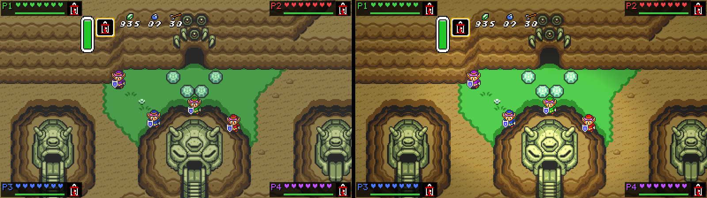</p>

*The same moment without (left) and with the 2D-HD look (right).*

*Pause menu > Video > 2D-HD look* (or `Hd2d = 1` in `zelda3.ini`) puts a
lens-and-light pass over the pixel art, in the style of Octopath Traveler.
*Video > 2D-HD settings* sets the strength of each part (0-100, also
`Hd2dDepthOfField`, `Hd2dLighting`, `Hd2dBloom`, `Hd2dGrade` and
`Hd2dVignette` in `zelda3.ini`, and `Hd2dSeeThrough`):

- **Depth of field**: the players are in focus and the screen goes softly out
  of focus above and below them, like a diorama. In split screen, each pane
  focuses on its own player. Far layers (a cave's distant floor, the void
  under a pit) are softer and hazy.
- **Lighting**: dark rooms are lit for real: a warm glow around each Link
  with the Lamp, lit torches, fire-rod fire and the big explosions, over a darkness that lifts
  as torches are lit. Without the Lamp a dark room stays dim, with the Links
  visible but no light around them (with the 2D-HD look off it is pitch
  black, as in the original game). Elsewhere fire glows, and so does a Link
  whose selected item is the Lamp.
- **Seeing through** (an option, off by default): a Link hidden behind a
  roof, bridge or door frame shows through it. Off, he stays hidden as in
  the original.
- **Bloom, color grade and vignette.**

Links, enemies and the HUD stay sharp, because the PPU reports which layer
every pixel came from. It only changes the picture, so it is safe in netplay
and each player can choose. It costs about 1-2 ms per frame. The code is in
`src/hd2d.c`.

## 3D view and first person (beta)

<p align="center">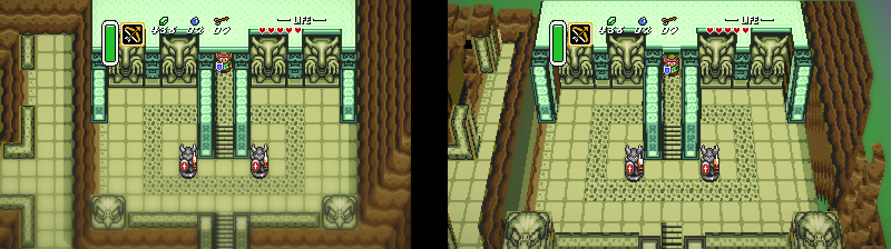</p>

*The original picture (left) and the 3D view at its starting angle (right).*

The 3D view builds the world as a little diorama from the game's own tiles:
walls, cliffs, pillars, statues and trees get real height, and Links,
enemies and items stand in it as flat cards that always face you, like the
sprites of HD-2D games. At its starting angle it looks almost exactly like
the original screen, with depth. Turn the camera and the room turns with
it; switch to first person and you walk through it at Link's eye height.

<p align="center">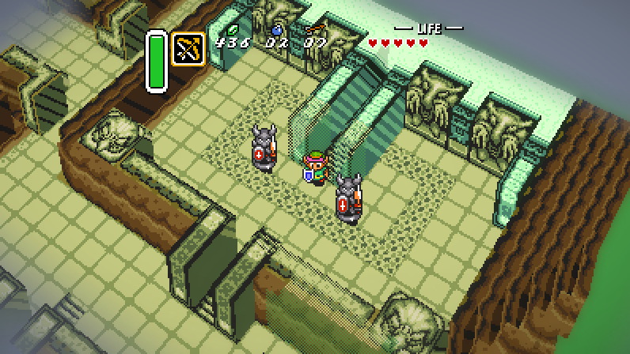 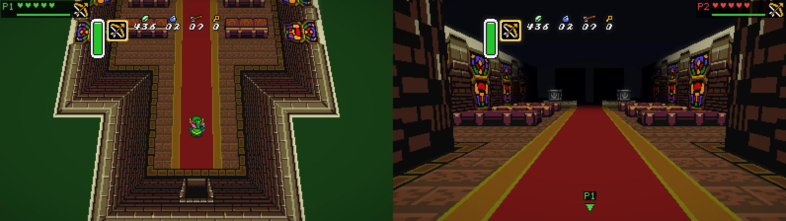</p>

*The camera turned (left). Split screen: a player in first person gets a pane of their own (right).*

<p align="center">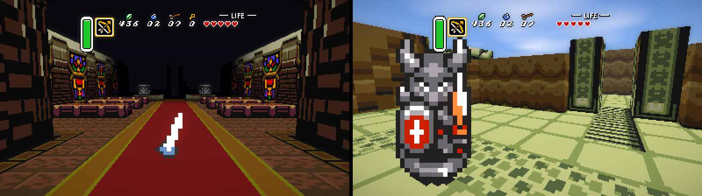</p>

*First person in the Sanctuary (left) and in the castle courtyard (right).*

**Turning it on.** *Pause menu > Video and HD options > 3D view (beta)*, or
`Hd3d = 1` in the `[Graphics]` section of `zelda3.ini`. It is off by
default. **F11** turns it on or off for a while, to compare (not saved).
*Video > 3D view settings* has everything else. The 3D view and the 2D-HD
look are separate options. Together they give the full HD-2D diorama: depth
of field from the real depth, bloom, color grade and the 2D-HD lighting.

**Controls.**

| | Keyboard and mouse (player 1) | Controller (any player) |
|---|---|---|
| First person on/off | **Left click**, or **Insert** | **L3** (click the left stick) |
| Turn and tilt the camera | Hold the **right mouse button** and move the mouse; or **Delete** / **Page Down** (turn), **Home** / **End** (tilt) | **Right stick** |
| Look around in first person | **The mouse** (while the cursor is captured), or the same keys | **Right stick** |
| Zoom (third person) | **Mouse wheel** (Ctrl + wheel still sizes the window) | |
| Back to the starting angle | **Middle click** or **Page Up** | **Hold L3** for half a second |

- **Moving.** Once the camera is turned, Up walks where the camera looks
  (in first person always): Left and Right go sideways, Down goes back.
  *Controls turn with camera* switches this off in third person. Link still
  faces and swings his sword in the game's four directions.
- **First person.** The view is at Link's eye height and starts facing where
  he faces. Your own Link is hidden, but not his sword: a swing, a spin
  attack or an item in his hand sweeps across the bottom of the view.
  Teammates, enemies and items are cards. After stairs to another floor, a
  building's door or a fall, the view turns to where Link comes out facing.
  *First-person view* sets the field of view (50-90 degrees). In split
  screen a player in first person always gets a pane of their own.
- **Third person.** *Camera returns* (on by default) eases the camera back to
  the starting angle two seconds after you let go. Once it is turned, your
  own Link shows as a faint silhouette where scenery hides him, and scenery
  right between the camera and Link is thinned out (*Fade scenery near
  Link*).
- **Faithful by default.** The game only runs what is on its own screen (and
  a little around it): enemies further away don't exist. So the world
  fades into mist where the original screen ends, a little further in first
  person. Dark rooms stay as dark as in the original (pitch black without
  the Lamp), or are lit by the 2D-HD lighting when that is on.
- **What stays 2D.** The item menu, the maps, the title and file select,
  the world map, game over, and moments the game draws with special screen
  effects (the spotlight when you enter a house, the mirror's wave, mosaic
  fades, Swamp Palace's water) show the normal picture, with a short
  crossfade. Overworld area changes, stairs between floors and falls are 2D
  for their moment too. Text boxes are drawn over the 3D view, as they are.
- **The View button and Ping.** L3 is the new View button for every player
  (*Controls* lets you move it; Insert for player 1's keys). R3, the right
  stick's click, is still Ping: pressing the stick in while you turn the
  camera pings. If that gets in the way, move Ping in *Pause menu > Controls*.
- **Online.** Each player picks their own view; only the picture changes,
  and for a turned camera which way the d-pad walks, which is worked out
  on your computer before your buttons are sent, so the game stays in sync.
- **Cost.** About 1-1.5 ms more per pane and frame than the flat picture
  (measured on a 4-core 2.1 GHz machine; with the 2D-HD look on, about 1 ms
  more than the 2D-HD look alone). It all runs on the CPU, so it works with
  every output method.
- **Known limits (beta).** Heights are worked out from the tiles, so some
  spots look odd: cliffs are blocks, stairs and ledges are flat, diagonal
  walls are steps, and the far side of a turned wall shows what the art
  drew there. Rooms whose floor or water moves, and a few boss rooms, stay
  2D.

The code is in `src/hd3d*.c` (scene, sprites, camera input, drawing),
`src/r3d.c` (the software rasterizer) and `src/cam3d.c` (the camera and
camera-relative movement). `tools/readme_shots.sh` makes the screenshots
above from your own ROM.

## Quick start (Linux / macOS)

```sh
sudo apt-get install libsdl2-dev python3-pil python3-yaml   # or: pip install -r requirements.txt
cp /path/to/your/Legend_of_Zelda_USA.sfc zelda3.sfc        # SHA1 6d4f10a8b10e10dbe624cb23cf03b88bb8252973
make -j                                                     # builds ./zelda3 and extracts zelda3_assets.dat
./zelda3
```

## Windows

1. Download the `zelda3-windows-<commit>` artifact from the latest
   [Build run](../../actions/workflows/build.yaml) and **unzip it** (running the
   exe from inside the zip won't work).
2. Copy your own ROM of *A Link to the Past (USA)* (`.sfc`/`.smc`, any name)
   into the folder.
3. Start `zelda3.exe` and choose **Extract now** (or run `extract_assets.bat`).
   This needs [Python 3](https://www.python.org/downloads/) once; tick
   "Add python.exe to PATH" when installing it.

To build it yourself: `run_with_tcc.bat` (downloads its own compiler), Visual
Studio (`Zelda3.sln`), or `tools/build_windows_mingw.sh` from Linux.

The ROM, `zelda3_assets.dat` and saves are gitignored. **Never commit them.**

## Controls

<p align="center">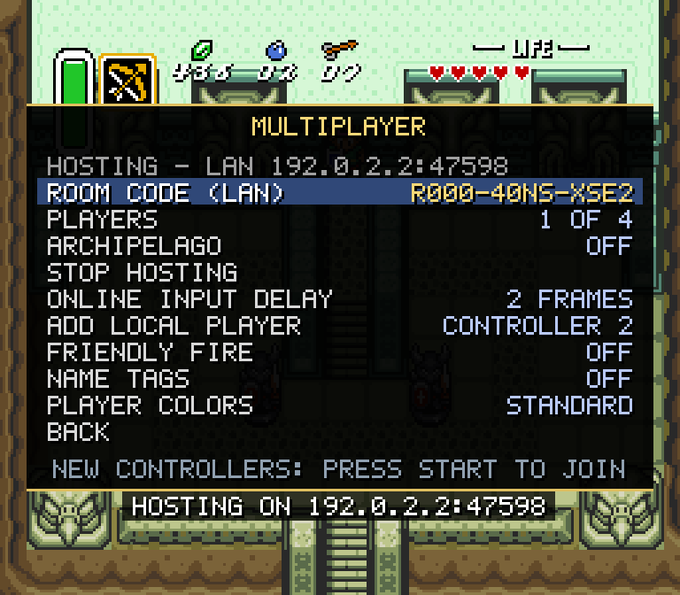</p>

- Keyboard: arrows, X = A, Z = B, S = X, A = Y, Enter = Start, Right Shift = Select.
- `Esc` (or the controller's Guide button, or Back+Start) opens the menu:
  Multiplayer, Video and HD options (widescreen 16:9/16:10/18:9, HD world map,
  smooth scaling, no sprite flicker, 2D-HD look, ...) and Gameplay options.
- Extra controllers press START to drop in as P2-P4.
- 3D view (when it is on): the right stick (or a right mouse drag) turns
  the camera, and a left click or L3 switches first person. See
  [3D view and first person](#3d-view-and-first-person-beta).

## Where to mod

- `src/` holds the game logic as C: `player.c` (Link), `sprite_main.c` (enemies/NPCs), `dungeon.c`, `overworld.c`, `ancilla.c` (projectiles/effects), `hud.c`.
- `src/mp.c` (multi-Link engine), `src/session.c` (netplay), `src/ui.c` (overlay and menus).
- `src/hd2d.c` (the 2D-HD look), `src/hd3d*.c`, `src/r3d.c` and `src/cam3d.c` (the 3D view).
- `assets/` holds the extracted resources (overworld/dungeon YAML, images, text). Edit these, then rebuild them with `python3 assets/restool.py` (see BUILDING.md).
- `zelda3.ini` holds the runtime options. The in-game menu saves its changes to `zelda3.coop.ini`.
- `tests/run_coop_tests.sh` runs headless co-op and netplay regression tests.

---

# Zelda3

A reimplementation of Zelda 3.

The upstream zelda3 project's Discord server (snesrev's, for the engine itself): https://discord.gg/AJJbJAzNNJ

## About

This is a reverse engineered clone of Zelda 3 - A Link to the Past.

It's around 70-80kLOC of C code, and reimplements all parts of the original game. The game is playable from start to end.

You need a copy of the ROM to extract game resources (levels, images). Then once that's done, the ROM is no longer needed.

It uses the PPU and DSP implementation from [LakeSnes](https://github.com/elzo-d/LakeSnes), but with lots of speed optimizations.
Additionally, it can be configured to also run the original machine code side by side. Then the RAM state is compared after each frame, to verify that the C implementation is correct.

I got much assistance from spannerism's Zelda 3 JP disassembly and the other ones that documented loads of function names and variables.

## Additional features

A bunch of features have been added that are not supported by the original game. Some of them are: basic widescreen, shaders, 240 vertical res, hi-res mode7 map, MSU-1 audio, item switching, and over 30 bugfixes.

## Building

You must self-build for now. Steps for 64-bit Windows:<br>
(0) Download [Python](https://www.python.org/ftp/python/3.11.4/python-3.11.4-amd64.exe) and install with "Add to PATH" checked<br>
(1) Click the green button "Code > Download ZIP" on the github page and extract the ZIP<br>
(2) Place your USA rom named zelda3.sfc in that folder<br>
(3) Download [TCC](https://github.com/FitzRoyX/tinycc/releases/download/tcc_20230519/tcc_20230519.zip) and [SDL2](https://github.com/libsdl-org/SDL/releases/download/release-2.28.2/SDL2-devel-2.28.2-VC.zip) and extract each ZIP into the "third-party" subfolder<br>
(4) Double-click "get_python_libs.bat" in the main dir.<br>
(5) Double-click "extract_assets.bat" in the main dir. This will create zelda3_assets.dat.<br>
(6) Double-click "run_with_tcc.bat" in the main dir. This will create zelda3.exe and run it.<br>
(7) Configure with zelda3.ini in a text editor like notepad++<br>

For other platforms and compilers, see: https://github.com/snesrev/zelda3/blob/main/BUILDING.md

## Usage and controls

The game supports snapshots. The joypad input history is also saved in the snapshot. It's thus possible to replay a playthrough in turbo mode to verify that the game behaves correctly.

The game is run with `./zelda3` and takes an optional path to the ROM-file, which will verify for each frame that the C code matches the original behavior.

| Button | Key         |
| ------ | ----------- |
| Up     | Up arrow    |
| Down   | Down arrow  |
| Left   | Left arrow  |
| Right  | Right arrow |
| Start  | Enter       |
| Select | Right shift |
| A      | X           |
| B      | Z           |
| X      | S           |
| Y      | A           |
| L      | C           |
| R      | V           |

The keys can be reconfigured in zelda3.ini

Additionally, the following commands are available:

| Key | Action                |
| --- | --------------------- |
| Tab | Turbo mode |
| W   | Fill health/magic     |
| Shift+W   | Fill rupees/bombs/arrows     |
| Ctrl+R | Reset            |
| Ctrl+E | Walk through walls (cheat) |
| P   | Pause (with dim)                |
| Shift+P   | Pause (without dim)                |
| Ctrl+Up   | Increase window size                |
| Ctrl+Down   | Decrease window size                |
| T   | Toggle replay turbo mode  |
| O   | Set dungeon key to 1  |
| K   | Clear all input history from the joypad log  |
| L   | Stop replaying a shapshot  |
| R   | Toggle between fast and slow renderer |
| F   | Display renderer performance |
| F1-F10 | Load snapshot      |
| Alt+Enter | Toggle Fullscreen     |
| Shift+F1-F10 | Save snapshot |
| Ctrl+F1-F10 | Replay the snapshot |
| 1-9 | Load a dungeons playthrough snapshot |
| Ctrl+1-9 | Run a dungeons playthrough in turbo mode |


## License

This project is licensed under the MIT license. See 'LICENSE.txt' for details.

## AI use

This project was made with an AI coding assistant. See
[AI_DISCLOSURE.txt](AI_DISCLOSURE.txt) for what was written with AI, what
wasn't, and how the work was checked.
