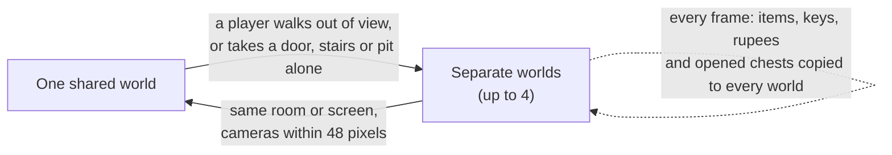
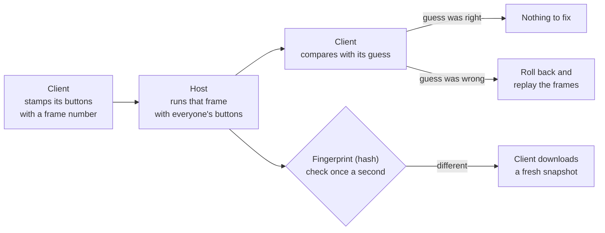

# How the Four Swords From the Past Mod Works

*Last updated October 11, 2026.* A plain-language guide to how the mod works.

## What this mod is

This mod turns *The Legend of Zelda: A Link to the Past* (Super Nintendo, 1991) into a PC game where up to four people play together, plus an item randomizer. It runs as a normal Windows, Mac or Linux program. No emulator is needed.

Here is everything it adds to the original game:

- **Four-player co-op.** Up to four Links play at once, on one computer, over a home network (LAN) or over the internet. Players can join or leave at any time.
- **Each Link looks different.** Player 1 is green, Player 2 red, Player 3 blue and Player 4 purple.
- **Personal hearts.** Each player's hearts show in their own corner of the screen.
- **One shared inventory.** Every item, key and rupee belongs to the whole team.
- **Free roaming.** Players can go anywhere, apart from each other. Players on the same computer get a split screen when they split up.
- **Ghosts and revives.** A Link that runs out of hearts becomes a ghost. A teammate can stand next to it to bring it back.
- **Friendly fire** can be turned on or off.
- **An item randomizer** that shuffles where items are found, and still makes sure the game can be beaten.
- **Widescreen and HD options**, and an in-game menu for all settings and controls.

The project is called *fourSwordsFromThePast*. The name mixes *Four Swords* (Nintendo's own four-player Zelda) with *A Link to the Past*.

## Where the game came from

The mod is built on **zelda3**, a free project by snesrev that rewrote the whole game in the C programming language. It is not built on an emulator.

**What "decompiled" means.** The original cartridge holds machine code for the Super Nintendo's processor. People studied that code for years and wrote C code that does exactly the same thing, step by step. That C code can be compiled into a PC program, so the game runs natively, the way any PC game does. Because it is now readable code, it can be changed. That is what makes a mod like this possible.

**The ROM and the assets.** The code does not include Nintendo's graphics, music, maps or text. Those come from your own copy of the game (a *ROM file*, the cartridge's data saved as a file).

- Once, a small Python script reads the ROM and creates `zelda3_assets.dat`, which holds the graphics, sound and level data.
- The game reads that file when it starts.
- Windows players get `extract_assets.bat`, which does this with a double-click. The game also offers to run it if the file is missing.

**Why the ROM is never shared.** The ROM and anything made from it belong to Nintendo. The project only ever contains the code, never the ROM or `zelda3_assets.dat`. Each player supplies their own copy. Only the US version of the game is supported.

**Inside the code, the game's memory is one big block.** The SNES has 128 KB of work memory, called *RAM*, and the C code keeps the whole game state in a 128 KB array called `g_ram`. Link's position, enemies, items and room data all sit at fixed spots in it. Almost every feature in this mod works by carefully copying, swapping or watching parts of that block.

## How four Links share one game

The original game only knows about one Link. The mod adds three more by giving each player a private copy of "Link's memory" and swapping copies in and out, very fast, many times per frame.

**The Link context.** About 400 bytes of RAM describe Link: where he stands, which way he faces, his sword swing, his health, what he is holding and so on. The mod calls this the *Link context*. The list of exactly which RAM addresses count as "Link" is in `src/mp.c` (`kMpCtxRanges`). Everything else (the room, enemies, items, story progress) is shared by all players.

**Swapping.** Each player has their own saved copy of the Link context. When the game needs to work with Player 3, the mod:

1. saves the current Link's bytes into that player's copy,
2. loads Player 3's copy into the real RAM spots,
3. runs the normal game code, which now "sees" Player 3 as Link.

The original code never knows other players exist. It just runs once per Link.

**What happens each frame** (the game runs 60 frames per second):

1. The **leader** (one of the players) is in RAM and plays normally. The camera, rooms, menus and cutscenes follow the leader.
2. After the leader moves, the mod swaps in each other player in turn and runs the same Link movement code for them (`Mp_RunOtherPlayers`).
3. Each **enemy** is run with the context of the nearest Link swapped in, so enemies chase and hit the closest player. Hit checks between swords and enemies try every Link.
4. Each **projectile** (arrow, bomb, boomerang) remembers who threw it and runs with that player's context.
5. Other players are drawn as extra sprites on top of the screen. The leader is drawn by the game's own sprite code.

**Who is the leader?** Whoever does something that changes the game's mode becomes the leader: opening the menu, talking to someone, opening a chest or going through a door. A downed leader hands the job to a standing player.

**Colors.** The tunic color lives in one small palette (16 colors). Before drawing, the mod copies that palette and recolors the tunic for each player: green, red, blue and purple. Because of this, armor upgrades still protect you but no longer change your tunic color.

**Shared inventory.** Items live outside the Link context, so they are naturally shared. The one exception is the Y-button item: each player picks their own.

## Free roaming: separate worlds that split and merge

Players can go anywhere they want, apart from each other. To make this work, the mod runs up to four copies of the game world at once, one for each group of players that is in a different place. The code is in `src/instance.c`.

**Why copies are needed.** The original game can only have one room loaded and one camera. If Player 1 is in a dungeon and Player 2 is on the overworld, they cannot share one game world. So each group gets its own *world instance*: its own RAM, its own picture-drawing state (PPU) and its own list of players.

**Every frame, each world runs in turn.** The mod points the game at World 1 and runs one frame, then points it at World 2 and runs a frame, and so on. Switching worlds just changes which memory block the game code uses, so it is fast.

**Splitting.** There are two ways a player gets their own world:

- **Taking an exit alone** (a door, stairs, a pit, the edge of an area). The frame is run normally, and the result becomes the new world for the traveler. Then the old world is rewound to before that frame and replayed without the traveler. That way the people left behind never see the traveler leave in a strange way.
- **Walking out of view.** If a non-leader gets close to the edge of the screen, a copy of the world is made for them, with them as leader. Their camera then slides over to center on them.

**Merging.** When two worlds are in the same room or overworld screen, and their cameras are within 48 pixels of each other, the players of one world move into the other. The extra world is thrown away. The camera rule keeps anyone's view from jumping.

**Shared progress.** Some things must stay the same in every world. The save-file part of memory (addresses 7EF000 to 7EF4FF) is compared every frame, and any change is copied into all worlds:

- items, heart containers, pendants and crystals,
- opened chests, doors and other room and overworld flags (these are combined, never removed),
- counters such as rupees, bombs, arrows, magic and keys (each world's change is added up, so two players spending bombs at once both count).

A few things stay per world: each player's health, the key count of the dungeon you are in, light or dark world, and the follower (like Zelda). Enemies and pots in a room can also differ between two worlds until they merge.

**Split screen.** If two or more players on the same computer are in different worlds, the window shows each world side by side (2 players) or in a 2×2 grid (3 or 4). Online players always see their own world. The sound comes from the world of the first player on that computer.

## Health, ghosts, reviving and game over

Each player has their own hearts, but nobody dies alone. A player who runs out of hearts becomes a ghost until a teammate revives them.

**Hearts.** Current health is part of each player's Link context, so it is personal. Heart containers raise everyone's maximum, because the maximum lives in the shared inventory. The game's own heart meter is hidden in co-op; instead each player's hearts are drawn in a corner: P1 top left, P2 top right, P3 bottom left, P4 bottom right.

**Going down.** Normally, losing your last heart starts the death scene. In co-op the mod catches that moment (`Mp_OnFatalDamage`). If any other player is still standing, in any world, the player becomes a **ghost** instead:

- the ghost flickers and lies still exactly where it fell,
- it cannot move, attack or be hurt,
- enemies ignore it.

**Reviving.** A standing teammate stands next to the ghost (within 24 pixels) for 1.5 seconds. The ghost gets up with half a heart. A small bar in the ghost's corner shows the progress.

**A ghost alone in a room.** If a ghost is the only player left in its world, that world is paused. It waits, frozen, until a standing teammate walks into the same room or screen. Then the worlds merge and the ghost is right where it fell.

Two special cases make sure a ghost can always be revived:

- **Stuck on a text box.** Sometimes a ghost's world is showing a message when it freezes (for example, Zelda calling out). Nobody in that world can press A to close it. The mod still lets that world merge, so the ghost can be revived.
- **A follower with the ghost.** If Zelda (or another follower) was following the player who went down, the reviver moves into the ghost's world, instead of the ghost being pulled out of it. That way the follower isn't lost.

**Fairies.** If the team has a fairy in a bottle, a player who would become a ghost is saved instead. The bottle empties and the player gets back up to 7 hearts. Bottles are shared like all items, so it is the team's fairy.

**Game over.** It is only game over when the last standing player goes down with no fairy. Then any ghosts in other worlds are pulled into that world, so everyone continues together from the same place.

**Friendly fire.** When it is turned on (host's choice), swords, arrows, rods, boomerangs, the hookshot and bombs can hurt teammates.

## Playing online

Online play works because the game is **deterministic**: if two computers start from the same state and get the same button presses, they end up in exactly the same state. So the computers never send each other the whole game. They only send button presses. The code is in `src/session.c`.

**The host and the clients.** One player hosts; up to three others join as clients. The host is the boss of the game: it decides what really happens in every *frame*. A frame holds:

- the buttons of all four player slots,
- who joined or left this frame,
- settings like friendly fire and the randomizer,
- whether music is playing (the only thing in the original game that depends on timing).

The host sends each frame to every client, and every computer runs it. The host never waits for a slow connection; it keeps going at 60 frames per second.

**The problem: lag.** Messages over the internet take time. If it takes 50 milliseconds for a message to go each way, a client's button press needs 100 milliseconds to reach the host and come back. If the client waited for that, its own Link would react late every time, which feels sluggish. The mod uses three tricks so that doesn't happen.

**Trick 1: buttons are sent ahead of time.** Every button press a client sends is stamped with the number of the frame it is meant for, like writing a date on a letter. The client aims to have each stamp arrive 1 to 3 frames *before* the host needs it. The host tells each client how early its buttons are arriving, and the client runs a tiny bit faster or slower until the timing is right. So the host almost always has the real buttons and never has to guess. Each button state is sent 8 times, in case some messages get lost on the way.

**Trick 2: the client predicts, and rolls back when it guessed wrong.** A client does not wait for the host. It shows its own Link moving right away. For the other players it makes a guess: *they are still holding the same buttons as last time*. That guess is usually right, because people hold a direction for many frames in a row.

- While guessing, the client saves a copy of the whole game after every frame, in memory.
- When the host's real frame arrives, the client compares it with its guess.
- If the guess was right, nothing changes.
- If it was wrong (someone changed direction), the client **rolls back**: it goes back to the last frame it knows is correct and quickly plays the frames again with the real buttons. A frame takes about 45 millionths of a second to run, so replaying even 15 frames happens far too fast to see.

This idea is called *rollback*. Fighting games use it too. Sounds from replayed frames are not played twice.

**Trick 3: corrections slide instead of jumping.** After a rollback, another player's Link may now be in a slightly different place than the client showed a moment ago. Instead of jumping there, it slides over a few frames. This only changes where the Link is drawn, never where it really is. (The Link that leads a world isn't slid, because the camera follows it.)

**Input delay.** Online, your buttons take effect 2 frames (about 1/30 of a second) after you press them. Most people can't feel that. Because of it, every computer learns everyone's buttons 2 frames sooner, so guesses are wrong less often and the corrections are smaller. You can change it with `InputDelay` in `zelda3.ini` (0 to 8).

**Joining a game in progress.** A new client first downloads a *snapshot*, a compressed copy of the whole game (every world, the save data and the co-op state). Then it fast-forwards through the frames that happened while it was downloading, and starts playing.

**Staying in sync.** Once a second, the host sends a *hash* of its game state: one number that changes if even one byte is different. Each client compares it with its own. If they differ ("out of sync"), the client quietly downloads a fresh snapshot.

**Finding each other.**

- **On a home network (LAN):** *Find LAN games* sends a broadcast message, and hosts answer.
- **Over the internet:** the host's game asks the router to open UDP port 47474 using **UPnP**, a standard way for programs to ask a router for this. If that fails, the host forwards the port by hand. Friends join with *Join by address*.

**Fair-play rules online.** Pause and turbo hotkeys do nothing during netplay, because they would freeze or outrun everyone else. Clients never write the host's world into their own save files. Everyone must use the same build of the game.

## The item randomizer

The randomizer moves items to new places, so every run of the game is a new puzzle. It also checks every arrangement to make sure the game can still be beaten. The code is in `src/randomizer.c`.

**Turning it on.** In *Pause menu > Gameplay*, set *Randomize new games* to on. It only affects save files created after that. Existing saves are never changed. Online, the host's setting is used.

**The seed.** A *seed* is a number that decides the whole arrangement. The same seed always gives the same item placement. The seed is stored inside the save file (at save address 7EF4F0), so a file stays randomized the same way after saving and loading. The menu shows the current game's seed, and you can choose to make new files with that same seed to race a friend.

**What gets shuffled.**

- The contents of all 168 chests, except small keys, big keys, maps and compasses. Those stay in their own dungeon, so dungeons still work the way they always did.
- Six places that give swords or shields (see the table).
- Items given by people for other reasons (Boots, Book, Flippers, Mirror, Flute, medallions) stay where they always are.

| Place | Original item | What happens when randomized |
| --- | --- | --- |
| The uncle, in the secret passage by the castle | Fighter's sword and shield | Gives two random items |
| Master Sword pedestal | Master Sword | Gives one random item |
| The smiths | Tempered sword | Work on any sword, once; give it back plus a random item |
| Pyramid fairy | Golden sword | Throw in any sword, once; get it back plus a random item |
| Waterfall of Wishing fairy | Red shield | Throw in any shield, once; get it back plus a random item |

**Progressive items.** Some items have levels. When you find one, you always get the next level up, no matter which version the chest held:

- swords: fighter's, then Master, then tempered, then golden,
- shields: fighter's, then red, then mirror,
- gloves: Power Glove, then Titan's Mitt,
- mail: blue, then red.

**Open start.** A randomized game skips the intro and the castle escape. It begins as if Zelda was already rescued: no rain, no guards blocking the way. Link starts at his house or the sanctuary, with no items, and can go anywhere.

**How the logic check works.** The randomizer knows, for every chest, which items are needed to reach it. For example, the Eastern Palace needs the Bow, the Lamp and a sword. It places items with a method called *assumed fill*:

1. Take the important items (Bow, Hookshot, Hammer, gloves, Moon Pearl, rods, Lamp, Cane of Somaria, Magic Cape, swords and shields) in a random order.
2. For each one, pretend you already have every important item not placed yet.
3. Put the item in a random chest you could reach with those items.
4. After all important items are placed, put the rest (rupees, bombs, arrows, heart pieces) anywhere.
5. Check: starting with nothing, can you collect everything and beat Ganon? If not, try again.

The check is careful on purpose. For example, it treats every chest in a dungeon as needing everything that dungeon needs. So a seed may be easier than the check thinks, but never harder. One Lamp is always placed in Link's house or the sanctuary, so dark rooms are never a problem early on.

To be safe, a few chests in unknown or hard-to-reach spots (like the castle basement, which normally opens during the escape) only ever get filler items.

## Menus, controls and settings

Everything can be changed from an in-game menu that is drawn on top of the game. Open it with `Esc`, a controller's Guide button, or Back+Start. The code is in `src/ui.c`.

| Menu screen | What it does |
| --- | --- |
| Multiplayer | Host a game, join by address, find LAN games, add or remove local players, friendly fire |
| Video and HD | Widescreen (16:9, 16:10, 18:9), HD world map, smooth scaling, window size, fullscreen |
| Gameplay | Randomizer, plus the original project's extras (switch items with L/R, bug fixes and more) |
| Controls | Set up each of the four players |
| Controls help | A short list of the default keys |

**Controls for each player** (`src/bindings.c`):

- two keyboard keys and two controller buttons for every SNES button,
- which controller a player uses, or keyboard only (so two players can share one keyboard),
- the left stick's deadzone, and a swap for Xbox versus Nintendo button layouts.

**Couch co-op.** The keyboard and the first controller are Player 1. Any other controller joins the game by pressing Start.

**Widescreen.** The game draws extra columns of the world to the left and right, so it fills a wide monitor instead of showing black bars.

**Settings files.** `zelda3.ini` holds all default settings with explanations. Changes made in the menu are saved to `zelda3.coop.ini`, which overrides the defaults.

## How it is tested and built

The mod has 26 automatic tests that play the game with no window, by following written scripts. They run with `tests/run_coop_tests.sh`.

**The test runner.** Running `zelda3 --mptest <script>` plays the game from a text file of commands such as "load save 2", "Player 2 holds Up", "run 300 frames" and "expect Player 2 to be downed". It can also take screenshots. The commands are listed at the top of `src/mptest.c`.

**What the tests cover:**

- co-op basics, combat, reviving, friendly fire and falling into holes,
- free roaming: splitting, merging, ghosts waiting in their room (also when stuck on a text box, or with Zelda following), game over,
- a stress test: four players wander randomly for 20,000 frames, and the test fails if any standing Link jumps (teleports), any ghost moves, or any visible Link is not drawn,
- online play: a real host and client talk over the network, and the client checks it stays in sync,
- online play over a bad connection: a *lag simulator* (`ZELDA3_NETSIM`) delays messages by 60 milliseconds, randomly adds up to 30 more and throws away 3% of them. Both players wander around, and the test fails if the game ever goes out of sync or the client's own Link ever jumps,
- the randomizer: 5,000 seeds are checked to be beatable and to contain exactly the original items, and real chests and the uncle are opened in the game.

**Building.** The code is built with a C compiler using the `Makefile` on Linux and Mac. For Windows there are three ways: Visual Studio (`zelda3.vcxproj`), a cross-build script (`tools/build_windows_mingw.sh`), or `run_with_tcc.bat`, which downloads a tiny compiler and builds the game on the player's own PC.

**Automatic builds.** Every time code is pushed to GitHub, a build job compiles Linux, Mac and Windows versions and saves them as downloadable files (*artifacts*).

## Common questions

**Is this an emulator?** No. The game was rewritten in C code that does the same thing as the original, so it runs as a real PC program. That is what lets it be changed so much.

**Does the mod include the game?** No. It includes only code. Each player uses their own copy of the US game, which is turned into a data file once.

**How can four Links exist when the game only knows one?** Each player has a private copy of Link's memory. The mod swaps copies in and out and runs the normal Link code once per player, every frame.

**How can players be in different places at the same time?** The mod runs up to four copies of the game world, one for each group. When groups meet, their worlds merge into one again.

**If players are in different worlds, why do they still share items?** Every frame, the save-file part of memory is compared across all worlds, and any change is copied to every world.

**Why doesn't online play send the whole game screen?** The game is deterministic, so sending only button presses is enough. Every computer runs the same frames and gets the same result.

**How does online play hide lag?** Each client shows its own moves right away and guesses the other players' buttons. When a guess turns out wrong, it rolls back and replays the frames with the real buttons, and other Links slide to their corrected spot. Buttons are also sent ahead of time, stamped with the frame they are for, so the host doesn't have to guess.

**Why does another player's Link sometimes slide a little online?** That is a correction: your computer guessed they kept holding the same direction, and they didn't. The higher the ping, the bigger the slide.

**What if two computers drift apart online?** Once a second they compare a hash, one number that sums up the game state. If it differs, the client downloads the host's game again.

**What happens when someone runs out of hearts?** They become a ghost where they fell. A teammate stands next to them for 1.5 seconds to revive them with half a heart. A bottled fairy saves them first. It is game over only when everyone is down.

**Can a randomized seed be impossible to beat?** The randomizer checks every seed before using it. It also plans with extra caution, so real play is never harder than what the check allows.

**Why do I sometimes find a weaker sword than the chest showed?** Swords, shields, gloves and mail are progressive. You always get the next level of what you have.

**Can I play the same randomized seed as a friend?** Yes. The Gameplay menu shows your game's seed and can make new files with it.

**Why can't I pause during an online game?** Pausing would freeze every other player too, so the pause keys do nothing online.

## Glossary

| Term | Meaning |
| --- | --- |
| Assumed fill | The randomizer's way of placing important items so that each one is reachable |
| Client | A player who joins someone else's online game |
| Decompiled | Rebuilt from the original machine code into readable code |
| Deterministic | Same start plus same inputs always gives the same result |
| Frame | One step of the game; it runs 60 per second |
| Ghost | A player with no hearts, waiting to be revived |
| Hash | One number that sums up a lot of data; it changes if any part changes |
| Host | The player whose computer runs the online game and sends frames to everyone |
| Input delay | Online, how many frames after a press it takes effect (2 by default) |
| LAN | A local network, such as everyone on the same home Wi-Fi |
| Leader | The player the camera, rooms and menus follow in a shared world |
| Link context | The roughly 400 bytes of memory that describe one Link |
| Merge | Two worlds becoming one when their players meet |
| Prediction | The client's guess at what the other players are pressing |
| Progressive item | An item that always gives the next level of what you have |
| RAM | The game's working memory; here a 128 KB block called `g_ram` |
| ROM | The game cartridge's data, saved as a file; each player supplies their own |
| Rollback | Going back to the last frame known to be right and replaying with the real buttons |
| Seed | The number that decides one randomized item placement |
| Snapshot | A compressed copy of the whole game, sent to players who join online |
| Split | A player getting their own world when they leave their group |
| UPnP | A standard way for a program to ask a router to open a port |
| World instance | One copy of the game world, used by one group of players |
