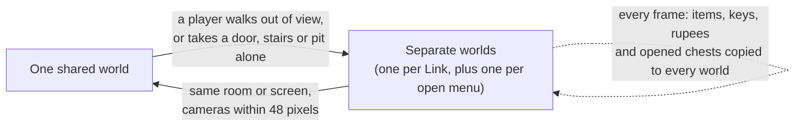
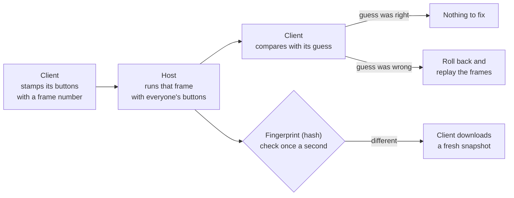
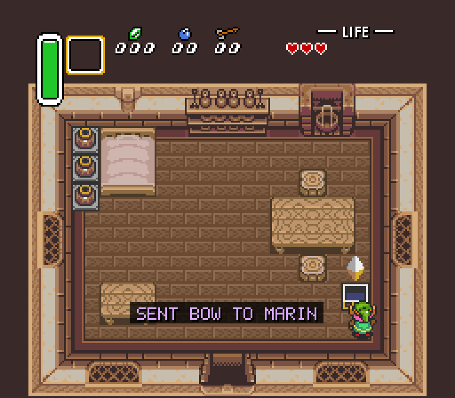
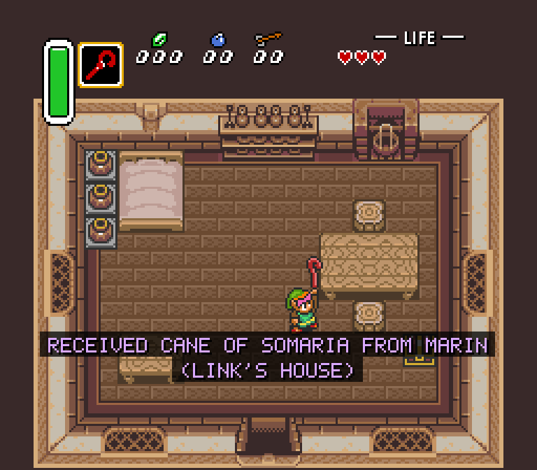
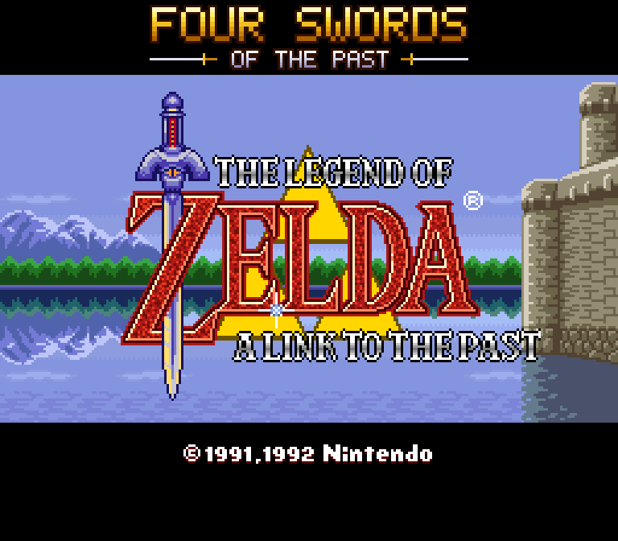
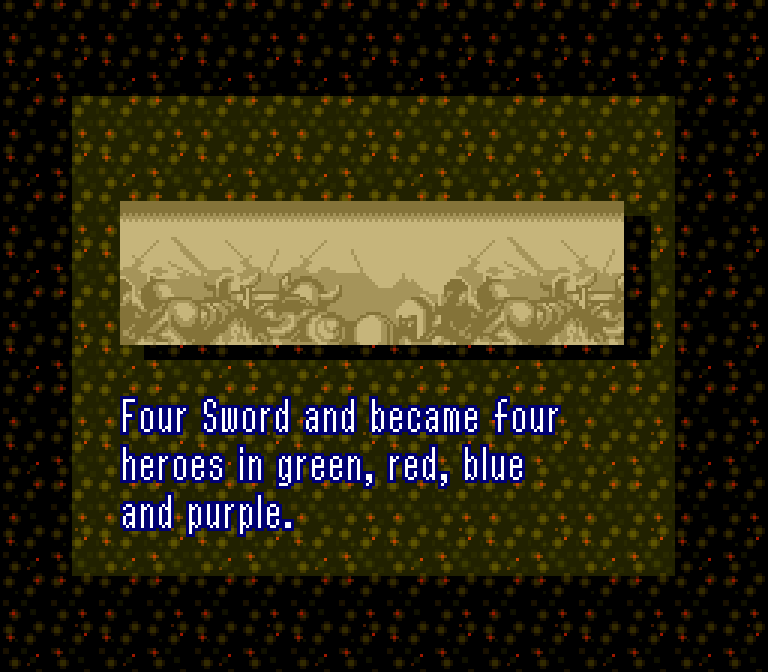

# How the Four Swords From the Past Mod Works

*Last updated October 13, 2026.* A plain-language guide to how the mod works.

## What this mod is

This mod turns *The Legend of Zelda: A Link to the Past* (Super Nintendo, 1991) into a PC game where up to four people play together, plus an item randomizer. It runs as a normal Windows, Mac or Linux program. No emulator is needed.

Here is everything it adds to the original game:

- **Four-player co-op.** Up to four Links play at once, on one computer, over a home network (LAN) or over the internet. Players can join or leave at any time.
- **Each Link looks different.** Player 1 is green, Player 2 red, Player 3 blue and Player 4 purple.
- **Personal hearts.** Each player's hearts show in their own corner of the screen.
- **One shared inventory.** Every item, key and rupee belongs to the whole team.
- **Free roaming.** Players can go anywhere, apart from each other. Players on the same computer get a split screen when they split up.
- **Ghosts and revives.** A Link that runs out of hearts becomes a ghost. A teammate can stand next to it to bring it back.
- **Friendly fire** can be turned on or off.
- **An item randomizer** that shuffles where items are found, and still makes sure the game can be beaten.
- **A full inventory for testing.** New save files can start with every item at its best.
- **A Four Swords opening.** The title says "Four Swords of the Past", and the legend that plays after it tells how four heroes were born from one blade.
- **Widescreen and HD options**, and an in-game menu for all settings and controls.

The project is called *fourSwordsFromThePast*. The name mixes *Four Swords* (Nintendo's own four-player Zelda) with *A Link to the Past*.

## Where the game came from

The mod is built on **zelda3**, a free project by snesrev that rewrote the whole game in the C programming language. It is not built on an emulator.

**What "decompiled" means.** The original cartridge holds machine code for the Super Nintendo's processor. People studied that code for years and wrote C code that does exactly the same thing, step by step. That C code can be compiled into a PC program, so the game runs natively, the way any PC game does. Because it is now readable code, it can be changed. That is what makes a mod like this possible.

**The ROM and the assets.** The code does not include Nintendo's graphics, music, maps or text. Those come from your own copy of the game (a *ROM file*, the cartridge's data saved as a file).

- Once, a small Python script reads the ROM and creates `zelda3_assets.dat`, which holds the graphics, sound and level data.
- The game reads that file when it starts.
- Windows players get `extract_assets.bat`, which does this with a double-click. The game also offers to run it if the file is missing.

**Why the ROM is never shared.** The ROM and anything made from it belong to Nintendo. The project only ever contains the code, never the ROM or `zelda3_assets.dat`. Each player supplies their own copy. Only the US version of the game is supported.

**Inside the code, the game's memory is one big block.** The SNES has 128 KB of work memory, called *RAM*, and the C code keeps the whole game state in a 128 KB array called `g_ram`. Link's position, enemies, items and room data all sit at fixed spots in it. Almost every feature in this mod works by carefully copying, swapping or watching parts of that block.

## How four Links share one game

The original game only knows about one Link. The mod adds three more by giving each player a private copy of "Link's memory" and swapping copies in and out, very fast, many times per frame.

**The Link context.** About 315 bytes of RAM describe Link: where he stands, which way he faces, his sword swing, his health, what he is holding and so on. The mod calls this the *Link context*. The list of exactly which RAM addresses count as "Link" is in `src/mp.c` (`kMpCtxRanges`). Everything else (the room, enemies, items, story progress) is shared by all players.

**Swapping.** Each player has their own saved copy of the Link context. When the game needs to work with Player 3, the mod:

1. saves the current Link's bytes into that player's copy,
2. loads Player 3's copy into the real RAM spots,
3. runs the normal game code, which now "sees" Player 3 as Link.

The original code never knows other players exist. It just runs once per Link.

**What happens each frame** (the game runs 60 frames per second):

1. The **leader** (one of the players) is in RAM and plays normally. The camera, rooms, menus and cutscenes follow the leader.
2. After the leader moves, the mod swaps in each other player in turn and runs the same Link movement code for them (`Mp_RunOtherPlayers`).
3. Each **enemy** is run with the context of the nearest Link swapped in, so enemies chase and hit the closest player. Hit checks between swords and enemies try every Link.
4. Each **projectile** (arrow, bomb, boomerang) remembers who threw it and runs with that player's context.
5. Other players are drawn as extra sprites on top of the screen. The leader is drawn by the game's own sprite code.

**Who is the leader?** Whoever does something that changes the game's mode becomes the leader: opening the menu, talking to someone, opening a chest or going through a door. A downed leader hands the job to a standing player.

**Screen transitions with a camera that is still catching up.** When Link walks off the edge of an overworld area, the game slides the camera to the next area a few pixels per frame and stops when the camera exactly reaches its target. With one Link the camera is always stopped at the area's edge when that happens. In co-op it can still be sliding over to its Link (after the worlds split, or after the leader changed because someone went down), so the slide used to step right past its target and scroll on forever, dragging Link across the map. Now, in co-op, a Link at the edge waits there until the camera has caught up and stopped at the edge too, and then the slide runs exactly as in the original game. (Jumping the camera there at once would leave parts of the map undrawn.) The slide also stops once it reaches or passes its target.

**Teammates at the edge of an area.** The game only checks the leader for walking off the edge of an overworld area, and only at the moment it crosses the line. A teammate who isn't leading (or is thrown) could walk right past the edge with no screen transition and end up outside the area, where the camera can't follow. Now a teammate who reaches the edge is held there and gets a world of their own, as its leader, so their next step there takes them on to the next area. That goes for a Link swimming, dashing or hopping along as a bunny too, leader or not (it once only went for one walking, so a swimming player was stuck at the edge for good). Only a Link flying through the air from a knockback or a throw, or hopping down a ledge, is kept inside the area until it lands.

**The camera in a shared world.** The game's camera follows Link, and in co-op "Link" is the leader, so the screen used to stay put while a teammate walked away from a standing leader: after about half a screen the teammate was pushed off the edge into a world of their own, and the leader walking off shoved a standing teammate out the same way. Now the camera of a world with several players keeps the middle of the group in view (`Mp_GroupTarget`): the scroll code still runs unchanged, but for that one call Link's position and speed are swapped for the group's middle and a slide toward it (1 to 4 pixels a frame, 4 when someone dashes), and put back right after. The leader never leaves the view (the target stays within 104 by 88 pixels of it), two Links walking or dashing side by side never split, a standing teammate is only pushed out when the pair is about 240 pixels apart instead of 136, and a lone Link keeps the original camera. The camera follows the leader alone again while it is held still by a text box or a cutscene, and when it is about to walk out of an overworld area, because that transition needs the camera exactly at the area's edge. Dungeon rooms clamp the camera as they always did. Walking back to the group after a split works the other way round: as soon as the lone player is in view of the group's camera, their own camera closes in on it (`Inst_NeighbourCamera` reads the other world's camera; every computer holds every world, so this is the same everywhere), and the worlds merge once the two cameras are within 12 pixels instead of 48, so rejoining happens on the way in and the picture hardly moves. On a shared screen, a teammate who opens the item menu or the map leads only while it is open (their choices land in their own state) and the lead goes back when it closes (`Mp_RestoreMenuLeader`), so the camera and the tethers don't start following whoever last looked at the map. The setting is the same on every machine, so netplay stays in lockstep.

**Why the camera can't follow a different player on each computer.** Online, every machine runs the same simulation, and the camera is part of it: the game reads the scroll position back every frame, sprites more than 64 pixels outside the camera's window are paused or removed, their screen positions are computed from it, and the overworld map in video memory is only a window around it that the game fills in one row or column at a time as it scrolls. A camera that differed per machine would desync the game and show missing enemies and unloaded map. What each computer does choose is which world its screen shows (its own player's, always), and free roaming gives every Link a private world, with its own camera, as soon as it leaves the shared view.

**Keeping the room in step with the leader.** In a dungeon, the game remembers which half of a big room Link is in, and only updates it as Link walks across the middle. That memory belongs to the whole world, not to one player. It isn't simply "the half Link stands in" (in Link's house it says the other half), but in each room the two differ in the same way. So the mod remembers that difference for the room, and after the leader changes it applies it to the new leader's position. (It skips moments when the leader stands in a doorway, where the game's door code updates the half on its own.) Without that, a player walking out of a room's exit right after becoming leader could be scrolled into the "other half" of the room instead, and end up back where they started.

**Colors.** The tunic color lives in one small palette (16 colors). Before drawing, the mod copies that palette and recolors the tunic for each player: green, red, blue and purple. Because of this, armor upgrades still protect you but no longer change your tunic color. A color-blind friendly set (bluish green, orange, blue and reddish purple, from the Okabe-Ito palette, which people with any kind of color blindness can tell apart) can be picked in the Multiplayer menu; it is used everywhere a player's color appears.

**Name tags and rumble.** Name tags (an option) draw a small P1-P4 over every Link. When a player's Link loses health, that player's own controller rumbles, harder for bigger hits (it can be turned off per player in the Controls menu). Both only happen on your own computer and change nothing in the game.

**Shared inventory.** Items live outside the Link context, so they are naturally shared. The one exception is the Y-button item: each player picks their own. On each player's screen, the item box at the top shows *their* item. (The game only knows how to draw one item box, so just before a screen is drawn the mod briefly swaps in that player's Link, draws the box, and puts everything back.)

**Your own magic meter.** Magic power is part of each player's Link context too, so every player has their own magic. Using the Fire Rod or the Cape uses up only your magic, and a magic jar only fills the meter of whoever picks it up. The HUD's magic meter is swapped in for each screen the same way as the item box, and each corner panel shows a small green magic bar under the hearts.

**Menus that don't pause.** Opening the item menu or a map would normally pause the whole game. In co-op, the player who opens it gets a world of their own just for the menu, and the frame is then played again in the old world without the menu, with that player's Link still there but marked "away": it stands still (its buttons go to the menu instead) and enemies can still reach it. So nothing pauses, even for a player alone in their part of the world. While away, the player is in two worlds: the menu world is what they see and control (`Inst_ViewOfPlayer`), and the old world is where their Link is (`Inst_OfPlayer`, used for hearts, arrows, name tags). When the menu closes, the menu world is dropped and the choices made there (the selected item, what the Y button uses, the bottle) are copied back to the Link. The menu world keeps the follower (the old man, Zelda) in the picture behind the menu. Select in the item menu (the game's "continue / save and quit" box) works in co-op too: save and quit fades out in the menu's world, saves the file with the follower, and takes everybody to the title screen. Playing alone, Start still pauses, as in the original.

**The item box.** The HUD's item box is one picture shared by the world, and it shows the leader's item. Another Link's control code may draw its own item there (switching with L/R, using up the last arrow, picking something up), so at the end of every frame the box is put back to the leader's item (`Hud_SyncItemBox`); a screen that belongs to another local player shows that player's item instead, at drawing time only.

**The options menu.** The menu drawn by the mod (Esc) also doesn't stop co-op: only the player who opened it stands still, and only their keys and controller move its cursor. The others keep playing.

**The map button.** X goes round three states: a mini map, the full screen map, no map. The press that turns on the mini map is taken away before the game sees it; the next one reaches the game and opens its map. (A text box or the item menu in between leaves the mini map alone.) Outdoors the mini map shows the game's own world map (built once from its mode 7 picture: 1 pixel for 16 of the overworld) around the player, with teammates in the same world as colored dots. In a dungeon it shows the current floor as the dungeon map lays it out (5 by 5 rooms), the rooms already seen filled in, all of them once the team has that dungeon's map.

**Teammates off to the side.** The game's code for drawing Link only expects Link near the middle of the screen. For a teammate far off to the right it got the sprites' position wrong, and they appeared wrapped around onto the left side of the screen. The mod works out each sprite's real position again and leaves out the ones that are off screen.

**Projectiles drawn with the right picture.** Some items, like the hookshot, draw their chain with pictures from Link's own graphics. The game only loads those for one Link, so another player's hookshot used to show the wrong pictures. The mod now draws those parts together with that player's own Link sprites, which have the right pictures.

## Free roaming: separate worlds that split and merge

Players can go anywhere they want, apart from each other. To make this work, the mod runs up to four copies of the game world at once, one for each group of players that is in a different place. The code is in `src/instance.c`.

**Why copies are needed.** The original game can only have one room loaded and one camera. If Player 1 is in a dungeon and Player 2 is on the overworld, they cannot share one game world. So each group gets its own *world instance*: its own RAM, its own picture-drawing state (PPU) and its own list of players.

**Every frame, each world runs in turn.** The mod points the game at World 1 and runs one frame, then points it at World 2 and runs a frame, and so on. Switching worlds just changes which memory block the game code uses, so it is fast.

**Splitting.** There are two ways a player gets their own world:

- **Taking an exit alone** (a door, stairs, a pit, the edge of an area). The frame is run normally, and the result becomes the new world for the traveler. Then the old world is rewound to before that frame and replayed without the traveler. That way the people left behind never see the traveler leave in a strange way. The game only looks for stairs under the Link in RAM (the leader), so the mod also checks every other Link after it moves: a teammate who walks into a staircase takes the lead and goes up or down it, in a world of its own when the others stay.
- **Walking out of view.** If a non-leader walks (mostly) off the edge of the screen, a copy of the world is made for them, with them as leader. Their camera then slides over to center on them. A Link standing on stairs or in a doorway right at the screen's edge is still in view, so it stays.

**Merging.** When two worlds are in the same room or overworld screen, and their cameras are within 48 pixels of each other, the players of one world move into the other. The extra world is thrown away, but not its kills: every enemy that died there (not one merely put away for being far off-screen) dies in the surviving world too, so nobody meets an enemy a teammate already killed. For that the mod keeps a record of killed area sprites next to the game's own "loaded" record (`overworld_sprite_killed`; indoors the game's per-room record is used), and merges it along with the players (`ApplySpriteKills`). A world is never merged away while one of its Links is held over a teammate's head or flying from a throw, or is busy with anything but walking, swimming or hopping along as a bunny. The camera rule keeps anyone's view from jumping. Right after someone walks out of view, the two worlds wait a second before they may merge, because the new camera is still sliding over to its player; otherwise they would merge straight back and split again, and the camera would jump between leaders.

**Seeing each other before merging.** Two worlds in the same room can have cameras far apart, for example while one player walks back toward the other. So nobody is invisible until the worlds merge, each world remembers where its Links were drawn. When a screen is drawn, the Links of every other world in the same room or area are drawn on it too, shifted by the difference between the two cameras. Drawing them changes nothing in the game, so it is safe online. A player in the item menu or a map is still drawn where their Link stands, and so is a Link on stairs: its world counts as being in the room still on its screen until the next room has loaded, so it doesn't vanish for the others (or see nobody itself) during the walk. When worlds merge, the Links moved over keep the sprites their old world drew that frame, so nobody blinks out.

**Shared progress.** Some things must stay the same in every world. The save-file part of memory (addresses 7EF000 to 7EF4FF) is compared every frame, and any change is copied into all worlds:

- items, heart containers, pendants and crystals,
- opened chests, doors and other room and overworld flags (these are combined, never removed),
- counters such as rupees, bombs, arrows and keys (each world's change is added up, so two players spending bombs at once both count).

A few things stay per world: each player's health and magic, the key count of the dungeon you are in, light or dark world, and the follower (like Zelda). The original game writes the state of the room you are in (doors unlocked, keys and chests taken) to the save only when you leave the room; the mod writes it as it changes, so a teammate's world that loads the room meanwhile finds it the same, and on a merge the room of the world that goes away is carried into the one that stays. A door a teammate unlocked or blew open also opens in a copy of the room that is already loaded, and costs nobody a second key. Enemies and pots in a room can still differ between two worlds until they merge. A chest can only be emptied once: if a teammate opened it in another copy of the room, it may still look closed in yours, but it is empty.

**Lifting and throwing teammates.** Like in Four Swords, you can pick up a teammate: face them while they stand right next to you and press A. They ride over your head and go wherever you go. Press A again to throw them about four tiles the way you face; they fly in an arc and land. The carried player can wriggle free with B. In the code, a throw is the game's own knockback (the arc Link flies in when an enemy hits him), only stronger and without damage, so walls stop it the way they always do. The game only checks for pits when a flying Link lands, so a thrown teammate sails over a gap about three tiles wide. While flying from a throw, ledge tiles count as open ground, so the throw carries on over a ledge instead of stopping at it. (Throwing someone up a cliff isn't possible: in this game a cliff face is simply a wall.) One bug was found on the way: a Link that came into a room through a door still had the game's "standing in a doorway" flag while being carried, and in a doorway knockback only goes along the door, so sideways throws went nowhere; a released Link now never counts as in a doorway. Who carries whom is part of the shared co-op state, so it plays out the same on every computer online.

A carried teammate stays on top through the trips its carrier makes: doors, stairs, entrances and exits, scrolling to the next area, hopping down a ledge, the mirror, and text boxes. (It used to be set down the moment a trip started; after an entrance the game then put it where the carrier arrived, which is the doorway itself, right on the way back out.) Only getting hurt, going down, the carried player wriggling free, or the game leaving play (dying, the ending) end a carry, and loading a save state starts everybody over with nobody held. During the trip the carried Link is moved with its carrier every frame, and while the carrier hops down a ledge it rides the carrier's height too. Nothing is let go in mid-air during a hop (a wriggle, a throw or a hit waits for the landing): the carried Link would start out from the cliff face.

**Blinking teammates.** A Link that was just hurt, or just put next to the leader after a door, blinks: the game leaves its sprites out every other frame. Without the widescreen visual fixes the game does that by setting the sprites' ninth x bit, which pushes them past the right edge of the screen. The mod works out every other Link's sprite positions again from where that Link really is (the game gets that bit wrong for a Link off to the side), and that undid the hiding: the blinking teammate showed as broken 8x8 pieces. Other Links are now drawn with the widescreen way of hiding, which moves the sprites below the screen.

**Flying with the flute.** The bird the flute calls carries off the whole shared world, like the mirror does: the others in it are set down next to the Link who played it. A Link put next to the leader gets a copy of the leader's state, minus what is its own (`Mp_RegroupPlayer`), and at that moment the bird is still setting the leader down: the leader is hidden and held still. The teammates used to keep that for good, invisible and unable to move. Now a Link put next to the leader starts out visible and free: not hidden, held still, knocked back or in the air, and not halfway through a bunny spell that hit the leader. It swims if it is put in the leader's water, and is a bunny like the leader in the Dark World without the Moon Pearl (it used to be put down walking either way: on the deep water, or as a Link with the bunny flag). The same goes for a player joining the game. If a ghost lies in the world, it stays where it fell and only the one who played the flute flies off, in a world of their own, as with any other way out of the area. The bird belongs to the Link who called it: if that Link leaves the world before it arrives, the bird leaves too, rather than picking up whoever leads there (one already setting its Link down still lands, and brings the follower along). While its caller is in the item menu or looking at the map, the bird waits out of sight and flies in again afterwards: it would carry off the Link standing in for that player, and the whole world into a map only that player could use. If its caller goes down before it arrives, it doesn't come at all (it would carry the ghost off). A fall or other trip the Link of a player in a menu makes on its own takes only that Link elsewhere. A world doesn't merge with another while a bird is about or a Link is held still, since the bird lives in one world only and nothing else would let go of the Link it carries. With free roaming off (a mode only the test scripts set, `together 1`), the player who played the flute leads on after the landing, unlike after a menu, where the lead goes back. No arrows to teammates and no mini map are drawn over the item menu, the maps or the flute's map.

**Bunny colors.** A bunny spell (or the Dark World without the Moon Pearl) puts the bunny's colors into its world's palette, and the game puts the gear's colors back only where the spell ends. So when the last bunny leaves a world (a bunny moving on to the next area, say), that world's colors go back to the gear's; otherwise everybody there kept the bunny's colors.

**Hookshot a teammate.** The hookshot latches onto a teammate the way it latches onto a block, and its owner is pulled over to them. The original pull already ignores pits, so this crosses any gap a teammate stands beyond: throw one Link across, and the others hookshot over to it. Right after the hook moves each frame (under its owner's context), the mod checks its tip against every other standing Link on the same floor (`Mp_HookTeammate`). On contact it moves the hook so that the game's own pull, which heads for a fixed offset from the hook, ends right beside the teammate, gives the pull enough frames to get all the way there, and sets the same "latched" flag a block would. The spot beside the teammate is checked first with the game's tile lookup; if it is a pit or deep water, the pull ends where the teammate stands instead (a spot off to the side of the teammate, because the pull only moves along the hook's line, is checked too). The hook only latches onto a teammate standing on the ground (not hopping or flying), and only when the end spot is ahead of the owner: the game's pull always heads the way the hook flew, so a teammate overlapping the owner would have pulled it backwards and then past them. Otherwise the hook flies on as if the teammate weren't there. Hooking a teammate never hurts, even with friendly fire on.

**Floor switches.** The game checks whether "Link" stands on a pressure plate or star tile by reading the one Link in RAM, the leader. In co-op, if the leader isn't on a switch, every other standing Link is asked in turn (`Mp_AnyLinkOnSwitch`), so one Link can hold a plate down while the others go through the door it opens. The plate sinking under its Link (a 2-pixel nudge) moves the Link that pressed it (remembered by player, so a change of leader meanwhile doesn't matter, and nobody is moved if that player left), and the leader keeps the lead and the camera. Ghosts and a Link held over someone's head don't press anything.

**Heavy rocks: lifting together.** Some rocks need the Power Glove or the Titan's Mitt. In co-op, two Links are one glove stronger: when a teammate stands right next to you (within 24 pixels) and holds A as well, the game counts one more glove level (`Mp_GloveLevelForLift`). Two Links without a glove can lift a gray rock, and two with the Power Glove a dark Titan's Mitt rock. This only ever adds a way through, so a randomizer seed that is beatable alone stays beatable.

**Arrows to teammates.** When a teammate is off your screen, a small arrow in their color at the edge of the screen points their way, with their player number. It works across worlds too, as long as the direction means something: you are both on the same overworld (light or dark), in the same dungeon, or in the same house or cave. A downed teammate's arrow is grey. The arrows are only drawn on your screen and change nothing in the game.

**Ping markers.** The Ping button is bit 12 of a player's input word, a bit the SNES pad doesn't have; the mod's input reading strips it before the game's own joypad code runs, so Link never reacts to it. Because it is part of the inputs that netplay already sends and checks, a ping costs nothing extra online. At the end of every frame (`Mp_HandlePings`) each world looks at the players whose Link is in it: a release after a short tap places a "look here" marker 24 pixels in front of the Link, holding for 20 frames places a "help" marker at the Link (a downed player's tap does too), with a half-second wait before the next one. The marker (where, which area or room, kind, frames left) is stored in the world's multiplayer state, so it is rolled back, saved and compared like the rest of the game, and every computer draws the same thing. The overlay (`DrawPings`) shows each marker to every pane in the same overworld, dungeon or house: rings that grow out from the spot while it's on screen, the arrow from the teammate arrows when it isn't, and a small square on the mini map. A marker stops showing once its world has left the area or room it was placed in. A world with only ghosts in it is frozen and skips its frames, but the ping part still runs there every frame, so its markers run out and a ghost alone can still call for help. The marker is laid out without any padding bytes, since the multiplayer state is hashed byte by byte to check that online games agree.

**Split screen.** If two or more players on the same computer are in different worlds, the window shows each world side by side (2 players) or in a 2×2 grid (3 or 4). Online players always see their own world. The sound comes from the world of the first player on that computer. With three players the fourth quarter would be empty, so it shows the team instead (`DrawTeamPanel`): the light and dark world maps, shrunk from the game's own map, with a dot for every player on the overworld, and a line per player with their hearts, whether they are down or reconnecting, and where they are (a dungeon by its name, a big area of the overworld such as Kakariko Village, or "indoors").

## Health, ghosts, reviving and game over

Each player has their own hearts, but nobody dies alone. A player who runs out of hearts becomes a ghost until a teammate revives them.

**Hearts.** Current health is part of each player's Link context, so it is personal. Heart containers raise everyone's maximum, because the maximum lives in the shared inventory. The game's own heart meter is hidden in co-op; instead each player's hearts are drawn in a corner: P1 top left, P2 top right, P3 bottom left, P4 bottom right.

**What's in a corner.** Besides the hearts and magic, each corner shows the item that player has on Y. It is the real item box picture: for a moment that player's state is swapped in and the game's own HUD code (`Hud_RefreshIcon`) works out the 2x2 tiles it would draw, everything is put back, and those tiles are turned into a little picture from that player's own world's video memory and palette (`Mp_ItemIconTiles`, `Inst_PlayerItemIcon`; worked out again when the item changes and twice a second for counts). Another world may be showing the map, whose colors would turn the icons strange. Online the corners show the players' names. A player low on hearts (below the same line at which the game beeps) gets flashing hearts. The game's low-health beep runs inside the simulation, so it can't be per player; it now sounds when any standing Link of the world is low, not only the one in RAM (`Mp_OtherLinkBelow`), and the flashing corner says whose hearts it is.

**Rumble.** Each player's own controller tells them what happens to their own Link: a hit (harder for a bigger one), going down, getting up again, being lifted, being thrown and landing, lifting someone, and a slow heartbeat while low on hearts. After every frame the game's state is compared with the frame before for each player on this computer (`RumbleForEvents`); nothing about it is part of the game, so online it is only ever felt on the computer of the player it is about.

**Going down.** Normally, losing your last heart starts the death scene. In co-op the mod catches that moment (`Mp_OnFatalDamage`). If any other player is still standing, in any world, the player becomes a **ghost** instead:

- the ghost is drawn in pale ghost colors and lies still exactly where it fell (it used to blink, which made it look like it kept popping up out of nowhere),
- it cannot move, attack or be hurt,
- enemies ignore it.

**Reviving.** A standing teammate stands next to the ghost (within 24 pixels) for 1.5 seconds. The ghost gets up with half a heart. A small bar in the ghost's corner shows the progress.

**Watching while you're down.** A ghost can't do anything, so its screen can show someone else: by default a standing teammate if the ghost's own world is paused, or else the ghost's own Link. Pressing **L** or **R** flips between your own Link and each standing teammate. A note at the bottom of the screen says who you are watching.

**Sending a heart.** A ghost can still help: pressing A sends a small heart that flutters down onto the nearest standing teammate in its world, like a heart an enemy drops. Then the ghost has to wait 20 seconds; a small heart in its corner of the screen shows when it is ready again. This happens inside the game's simulation (`Mp_GhostHelp`), driven by the ghost's own button presses, so online it plays out the same on every computer.

**Letting go.** A Link that goes down drops whatever it carried (a bush or pot falls the way it does when a carrying Link gets hit; a carried teammate is set down). If its player was in the item menu, the menu closes. Standing players are counted where their Link is, never in a menu's world, so if that was the last Link standing, it is game over.

**A ghost alone in a room.** If a ghost is the only player left in its world, that world is paused. It waits, frozen, until a standing teammate walks into the same room or screen. Then the worlds merge and the ghost is right where it fell.

Two special cases make sure a ghost can always be revived:

- **Stuck on a text box.** Sometimes a ghost's world is showing a message when it freezes (for example, Zelda calling out). Nobody in that world can press A to close it. The mod still lets that world merge, so the ghost can be revived.
- **A follower with the ghost.** If Zelda (or another follower) was following the player who went down, the reviver moves into the ghost's world, instead of the ghost being pulled out of it. That way the follower isn't lost.

**Fairies.** If the team has a fairy in a bottle, a player who would become a ghost is saved instead. The bottle empties and the player gets back up to 7 hearts. Bottles are shared like all items, so it is the team's fairy.

**Game over.** It is only game over when the last standing player goes down with no fairy. Then any ghosts in other worlds are pulled into that world, so everyone continues together from the same place.

**Friendly fire.** When it is turned on (host's choice), swords, arrows, rods, boomerangs and bombs can hurt teammates. (The hookshot never does: it latches onto them.)

## Playing online

Online play works because the game is **deterministic**: if two computers start from the same state and get the same button presses, they end up in exactly the same state. So the computers never send each other the whole game. They only send button presses. The code is in `src/session.c`.

**The host and the clients.** One player hosts; up to three others join as clients. The host is the boss of the game: it decides what really happens in every *frame*. A frame holds:

- the buttons of all four player slots,
- who joined or left this frame,
- settings like friendly fire, the randomizer and the full inventory,
- whether music is playing (the only thing in the original game that depends on timing).

The host sends each frame to every client, and every computer runs it. The host never waits for a slow connection; it keeps going at 60 frames per second.

**The problem: lag.** Messages over the internet take time. If it takes 50 milliseconds for a message to go each way, a client's button press needs 100 milliseconds to reach the host and come back. If the client waited for that, its own Link would react late every time, which feels sluggish. The mod uses three tricks so that doesn't happen.

**Trick 1: buttons are sent ahead of time.** Every button press a client sends is stamped with the number of the frame it is meant for, like writing a date on a letter. The client aims to have each stamp arrive 1 to 3 frames *before* the host needs it. The host tells each client how early its buttons are arriving, and the client runs a tiny bit faster or slower until the timing is right. So the host almost always has the real buttons and never has to guess. Each button state is sent 8 times, in case some messages get lost on the way.

**Trick 2: the client predicts, and rolls back when it guessed wrong.** A client does not wait for the host. It shows its own Link moving right away. For the other players it makes a guess: *they are still holding the same buttons as last time*. That guess is usually right, because people hold a direction for many frames in a row.

- While guessing, the client saves a copy of the whole game after every frame, in memory.
- When the host's real frame arrives, the client compares it with its guess.
- If the guess was right, nothing changes.
- If it was wrong (someone changed direction), the client **rolls back**: it goes back to the last frame it knows is correct and quickly plays the frames again with the real buttons. A frame takes about 45 millionths of a second to run, so replaying even 15 frames happens far too fast to see.

This idea is called *rollback*. Fighting games use it too. Sounds from replayed frames are not played twice.

**The host guesses too, but never decides with a guess.** The host also runs ahead without waiting. If a client's buttons arrive a little late, the host has already guessed them, so it rolls back and replays with the real ones, just like a client. A frame becomes final, and is sent out, only once the host has everyone's real buttons for it. (A player whose connection goes silent for half a second isn't waited for.) This matters: if a guess about *your* buttons ever became final, your own Link would snap back to where the guess put it ("rubber banding"), and a door or stairs you took could be undone. With this rule, your own Link is only ever moved by your own buttons.

**Keeping up on a slow link.** For that rule to hold, a client's buttons must reach the host before the host gives up waiting, which means the client must run at least a round trip ahead. Two limits used to stop that on slow connections. The host sent at most 32 frames per packet, starting from the oldest frame the client still needed, and it only learns that a round trip late; with a round trip longer than 32 frames (about half a second) the client fell further and further behind. And a client could run at most 48 frames ahead, less than a slow round trip plus the 30 frames the host waits. Then the host had to finalize frames with guessed buttons, the client's own Link snapped back, and a soldier the client had just killed stood up again when the client rolled back to the host's version: the "enemies come back with lag" bug. Now the host sends as many frames as fit in one packet (about 95), and a client may run up to 90 frames ahead. In a test fight over a 300 ms link (each way, with jitter and 5% loss), soldiers coming back dropped from 28 to at most 1 and the client's own buttons were never guessed. (With high ping a few kills can still be undone: if another player did something other than the guess and that changes the fight, the rollback shows what really happened. That is inherent to prediction; a higher input delay in the Multiplayer menu makes it rarer.)

**Trick 3: corrections slide instead of jumping.** After a rollback, another player's Link may now be in a slightly different place than the client showed a moment ago. Instead of jumping there, it slides over a few frames. This only changes where the Link is drawn, never where it really is. Your own Link slides too in the rare case a rollback moves it: your buttons are never guessed, but what a teammate really did can change what an enemy did to you, a knockback say. (The Link that leads a world isn't slid, because the camera follows it.)

**Input delay.** Online, your buttons take effect 2 frames (about 1/30 of a second) after you press them. Most people can't feel that. Because of it, every computer learns everyone's buttons 2 frames sooner, so guesses are wrong less often and the corrections are smaller. You can change it in *Pause menu > Multiplayer > Online input delay* (0 to 8 frames).

**Joining a game in progress.** A new client first downloads a *snapshot*, a compressed copy of the whole game (every world, the save data and the co-op state). Then it fast-forwards through the frames that happened while it was downloading, and starts playing. (Each piece of the snapshot is sent once; what got lost on the way is sent again once the rest has arrived, so a slow connection isn't flooded with copies.)

**Staying in sync.** Once a second, the host sends a *hash* of its game state: one number that changes if even one byte is different. Each client compares it with its own. If they differ ("out of sync"), the client quietly downloads a fresh snapshot.

**Finding each other.**

- **On a home network (LAN):** *Find LAN games* sends a broadcast message, and hosts answer.
- **Over the internet:** the host's game asks the router to open UDP port 47474 using **UPnP**, a standard way for programs to ask a router for this. The router is asked for a two-hour lease that is renewed while hosting (so nothing is left behind if the game dies), all from a helper thread, so the game never waits for the router. If that fails, the host forwards the port by hand. Friends join with *Join by address*. A host on another port still answers *Find LAN games* on 47474.

**Room codes.** Instead of reading out an IP address, the host gives the others a *room code* like `FW00-00DS-EB52`. There is no server behind it: the code *is* the address. It holds the host's public IPv4 address (32 bits) and port (16 bits) plus a 12-bit check, written as 12 characters of Crockford's base 32, an alphabet without I, L, O or U so nothing looks alike. Typing it in lower case, without the dashes, or with the letter O for a zero still works, and a mistyped code fails the check instead of connecting somewhere else. The public address comes from the router through UPnP; when the router won't do UPnP, the game asks a STUN server (`StunServer` in `zelda3.ini`), which simply answers with the address the question came from, and the menu says to forward the port by hand.

**When a connection drops.** Wi-Fi hiccups shouldn't end a game. The host gives every client a secret *token* when it joins. If the host hears nothing from a client for 6 seconds, it *parks* that client: its players keep their seats, their Links stand still (the host decides their buttons are all released, so every computer still runs the same game), and nobody waits for them. The client, after 6 silent seconds of its own, shows "reconnecting" and keeps knocking with its token. When the host hears it again, from whatever address the client now has, the client gets its seat back and downloads the game afresh, since it missed what happened meanwhile. A player whose game crashed or was restarted has no token any more, so the host also recognises them by their name: only when exactly one waiting seat has that name (or one that went quiet from the same internet address), because by default everybody is called "Link" and a stranger must never get someone else's seat. That player then gets a new token, so an old copy of their game can't take the seat back. A client that drops before it ever got into the game is simply dropped, and while any client downloads the game (again) its Links stand still. After two minutes the seat is given up and the Links leave, as when someone quits. A player the host removed is refused if they knock again.

**Who's playing.** Twice a second the host sends everyone the list of seats: each player's name, whether they are playing or reconnecting (and how long their seat still waits), and their ping as their own computer measures it. *Multiplayer > Players* shows it together with where each player is, which every computer can work out from its own copy of the game. The host can remove a player there; the removed client is told so and goes back to playing alone.

**Keeping a copy of the host's game.** A client plays in the host's world, so it never saves into its own files. *Keep a copy in* writes the game's current progress (the 1,280 bytes the game itself saves) into one of the client's own three files, with the checksum and backup copy the file select screen expects. The copy is written straight to the save file on disk; the host's save data in memory isn't touched.

**Fair-play rules online.** Pause and turbo hotkeys do nothing during netplay, because they would freeze or outrun everyone else. Clients never write the host's world into their own save files. Everyone must use the same build of the game.

## The item randomizer

The randomizer moves items to new places, so every run of the game is a new puzzle. It also checks every arrangement to make sure the game can still be beaten. The code is in `src/randomizer.c`.

**Turning it on.** In *Pause menu > Gameplay*, set *Randomize new games* to on. It only affects save files created after that. Existing saves are never changed. Online, the host's setting is used.

**The seed.** A *seed* is a number that decides the whole arrangement. The same seed gives the same item placement as long as the placement itself doesn't change between builds (see *Chests that aren't there* below): a file keeps the placement it was made with, but a new file always gets the newest one, so to race a friend on a seed, use the same build. The seed is stored inside the save file (at save address 7EF4F0), so a file stays randomized the same way after saving and loading. The menu shows the current game's seed, and you can choose to make new files with that same seed to race a friend. To play a friend's seed, use *Enter a seed*: type its 8 characters (0-9 and A-F), or pick each one with Left and Right on a controller. The file select screen then says which seed new files will get.

**Spoiler log.** *Write spoiler log* saves a text file named after the seed. It lists the important items round by round (the first round is everything you can get from the start, the next round what those items open up, and so on), then every location and what it holds.

**What gets shuffled.**

- The contents of all 168 chests, except small keys, big keys, maps and compasses. Those stay in their own dungeon, so dungeons still work the way they always did.
- Six places that give swords or shields (see the table).
- Items given by people for other reasons (Boots, Book, Flippers, Mirror, Flute, medallions) stay where they always are.

| Place | Original item | What happens when randomized |
| --- | --- | --- |
| The uncle, in the secret passage by the castle | Fighter's sword and shield | Gives two random items |
| Master Sword pedestal | Master Sword | Gives one random item |
| The smiths | Tempered sword | Work on any sword, once; give it back plus a random item |
| Pyramid fairy | Golden sword | Throw in any sword, once; get it back plus a random item |
| Waterfall of Wishing fairy | Red shield | Throw in any shield, once; get it back plus a random item |

**Progressive items.** Some items have levels. When you find one, you always get the next level up, no matter which version the chest held:

- swords: fighter's, then Master, then tempered, then golden,
- shields: fighter's, then red, then mirror,
- gloves: Power Glove, then Titan's Mitt,
- mail: blue, then red,
- boomerangs: blue, then red.

**Open start.** A randomized game skips the intro and the castle escape. It begins as if Zelda was already rescued: no rain, no guards blocking the way. Link starts at his house or the sanctuary, with no items, and can go anywhere.

**How the logic check works.** The randomizer knows, for every chest, which items are needed to reach it. For example, the Eastern Palace needs the Bow, the Lamp and a sword. It places items with a method called *assumed fill*:

1. Take the important items (Bow, Hookshot, Hammer, gloves, Moon Pearl, rods, Lamp, Cane of Somaria, Magic Cape, swords and shields) in a random order.
2. For each one, pretend you already have every important item not placed yet.
3. Put the item in a random chest you could reach with those items.
4. After all important items are placed, put the rest (rupees, bombs, arrows, heart pieces) anywhere.
5. Check: starting with nothing, can you collect everything and beat Ganon? If not, try again.

The check is careful on purpose. For example, it treats every chest in a dungeon as needing everything that dungeon needs. So a seed may be easier than the check thinks, but never harder. One Lamp is always placed in Link's house or the sanctuary, so dark rooms are never a problem early on.

To be safe, a few chests in unknown or hard-to-reach spots (like the castle basement, which normally opens during the escape) only ever get filler items.

**Chests that aren't there.** The game's chest list has a few entries for rooms that have no chest at all (other randomizers move those chests elsewhere). Older builds could put items there, even important ones, where nobody could ever get them. New files leave those entries out. Each file stores which version of the placement it was made with (save address 7EF4F9), so files made with an older build keep exactly the items they had. Version 2 fixed two mistakes in the logic: Turtle Rock didn't count as needing a sword (its entrance needs Quake, which only works with one), and the castle basement and sewer chests could still get important items.

## Archipelago: one game in a multiworld

[Archipelago](https://archipelago.gg) connects randomizers of many different games. All the players' items are shuffled together, so your chest may hold an item for someone playing another game, and theirs may hold your Hookshot. A server keeps track of who found what and sends every item to its owner. The README has the steps for playing; this is how it works inside.

**Our own world.** Archipelago needs a *world* for each game: a small Python package that knows the game's locations, its items and what each location needs. Ours is in `archipelago/fsotp` and is called *Four Swords of the Past*. Its 106 locations are the places the built-in randomizer shuffles: the 100 chests that don't hold dungeon items, plus the uncle's two items, the pedestal, the smiths and the two fairies. Its logic (`rules.py`) is the randomizer's logic written again in Python, and a test feeds thousands of item combinations to both and checks they always agree. The chest names come from Archipelago's own *A Link to the Past* world, so players recognise them.

 

**An Archipelago save file.** While the game is connected to a room, a new save file becomes a file of that room: it is marked (7EF407) and remembers the room (7EF408). It is randomized like any randomized file (open start, progressive items), but the chests don't know what they hold. Opening one gives the *Archipelago item*, a white crystal that gives nothing, and sets that location's bit in the save (7EF418, one bit per location). The game sends those bits to the server, the server answers who gets what, and messages at the bottom of the screen tell the story.

**Receiving items.** The server keeps a numbered list of everything sent to our slot, our own finds included. The save counts how many of them were received (7EF410). Each frame, the host looks at the next one on the list and, as soon as some Link could take it, puts it into the frame it is about to play. Inside the game, it goes to the first Link who is free to hold it up (on the ground, not in a menu, text box or transition, no other Link of that world holding up an item, and a free slot for the item's sprite), and the count goes up by one. If nobody is free in that frame after all, nothing happens and the host offers it again once somebody is. (It doesn't offer it with every frame meanwhile: the other computers play a frame with an event again, as their guess of it had none, and with a text box open that would be every frame.) This also makes the items safe with online play: every computer plays the same frames, so every computer gives the same item to the same Link at the same moment, and a rollback that changes who was free just leads to the item being offered again. Only the item codes our world puts into the pool are handed out; anything else the server sends is skipped (and counted), because a crystal or a pendant, say, starts a sequence that only works in its own place.

**Sending.** What the game sends to the server (checked locations, beating Ganon, a game over for DeathLink) is read from the save as it is after the newest frame that can no longer change. The host never sends anything that a rollback could still undo. Without a connection the save keeps the checked locations and the goal, and connecting sends them again (the server ignores what it already knew). A game over is news only while it happens: the save counts the game overs since the file was loaded (7EF413), and only a new one is sent. One from before the connection, or the count going down because a file or a saved state was loaded, isn't anybody's death.

**DeathLink.** An optional link between players: when one dies, everyone with DeathLink dies. A death of ours is a game over (the whole team down), but not when a fairy in a bottle brings the last Link back. A death that comes in is put into a frame like an item. Every standing Link goes down; one that is busy (in a menu, a text box or a transition, or holding up an item that is only added when the hold-up ends) goes down as soon as it is free. The last one falls as if hit, into the game's own game over: as in the original game, a fairy in a bottle brings it back, and the team plays on together (the others get up with it). That game over isn't sent back, and a death that comes in during a game over of ours is over with it. The DeathLink still to hand out is a save byte (7EF412), set and cleared in every world alike, so every computer plays it out in the same frames.

**The connection.** `src/ap_client.c` talks to the server on its own thread, so the game never waits for the internet and the server's "are you still there?" pings are always answered. Archipelago speaks JSON over a WebSocket; encrypted connections (wss) use the computer's own TLS library, loaded when needed, so the game has no new requirements. Only the host (or the single player) connects; in online co-op the others get everything through the host's frames.

## Starting with every item (for testing)

*Pause menu > Gameplay > Start new games with all items* (`FullInventory` in `zelda3.ini`) is meant for testing: a save file created while it is on starts with every item at its best. That means the golden sword, the mirror shield, the red mail, the bow with silver arrows, the Titan's Mitt, all rods, canes and medallions, 20 full hearts, four bottles, and the most bombs, arrows and rupees. The shovel and the mushroom share their slots with the flute and the magic powder, so the file gets the flute and the powder. Pendants, crystals and dungeon items are not given. The code is `GiveFullInventory` in `src/select_file.c`.

**Why it starts open.** In the original game the sword can't be swung before Link meets his uncle, and with a better sword than the uncle's, Zelda is no longer in her cell. So a full file starts open like a randomized one: no intro and no castle escape. In a file that isn't randomized the uncle is gone too, because all he does is hand over his sword and shield.

**Nothing goes down a level.** The original game writes an item's level when Link gets it, without looking at what he has. The Master Sword would replace the golden sword, and the Bow's chest would take the silver arrows away. A full file is marked in the save (address 7EF4F8), and in a marked file a found item never lowers one Link already has. Files made without the option behave exactly as in the original game.

Online, the host's setting is used, like the randomizer's: it travels with every frame, because the file is made inside the game's simulation on every machine.

## The Four Swords story and title

The mod gives the game a new opening that fits its four heroes. Both parts can be turned off in *Pause menu > Gameplay*.

**The title.** "FOUR SWORDS" in big gold letters, with "OF THE PAST" below it, sits in the black band above the title picture. It is drawn on top of the finished picture by the same code that draws the menus (`src/ui.c`), so the original title graphics are untouched. It fades in and out with the screen.

 

**The story.** After the title screen waits a while, the game plays its legend: pictures of the Golden Land, then Agahnim in the throne room, then Zelda in prison. The mod tells a new story over the same pictures:

1. Long ago, seven wise men hid the Golden Power in a secret land. Beside it they laid the Four Sword, a blade that could split one hero into four.
2. The thief Ganon broke into the Golden Land and seized its power, and darkness flowed over Hyrule. A young knight drew the Four Sword and became four heroes in green, red, blue and purple.
3. Together they sealed Ganon away, and the four heroes faded into legend.
4. Ages later, the wizard Agahnim came to break the seal, struck down the King, and made the heirs of the wise men and the four knights vanish.
5. Princess Zelda is next, but the Four Sword stirs again, calling for four heroes.

**How it works.** All of the game's text is stored in one list of messages, and one function reads a message before it is shown (`Text_LoadCharacterBuffer`). When the story is on, that function gets the new text for the four legend messages from `src/story.c` instead. The new text is written as plain English with the game's own commands in brackets, like `[Scroll]` and `[Wait 09]`. When the game starts, the mod turns it into the game's text code. The text contains `[NextPic]` commands that move the legend on to its next picture, so the new story keeps the same picture changes as the original. The legend also ends on a timer, so the new text is no longer than the old.

**Online.** The length of the story changes how long the opening takes, so every computer must use the same setting. The host's setting travels with every frame it sends.

## Menus, controls and settings

Everything can be changed from an in-game menu that is drawn on top of the game. Open it with `Esc`, a controller's Guide button, or Back+Start. The code is in `src/ui.c`.

| Menu screen | What it does |
| --- | --- |
| Multiplayer | Host a game, join by address, find LAN games, add or remove local players, friendly fire, name tags, color-blind friendly colors |
| Video and HD | Widescreen (16:9, 16:10, 18:9), HD world map, smooth scaling, window size, fullscreen, the 2D-HD look and its settings |
| Gameplay | Randomizer, starting with all items, the Four Swords story and title, plus the original project's extras (switch items with L/R, bug fixes and more) |
| Controls | Set up each of the four players (keys, buttons, controller, stick, rumble) |
| Controls help | A short list of the default keys |

**Controls for each player** (`src/bindings.c`):

- two keyboard keys and two controller buttons for every SNES button,
- which controller a player uses, or keyboard only (so two players can share one keyboard),
- the left stick's deadzone, and a swap for Xbox versus Nintendo button layouts.

**Couch co-op.** The keyboard and the first controller are Player 1. Any other controller joins the game by pressing Start.

**Widescreen.** The game draws extra columns of the world to the left and right, so it fills a wide monitor instead of showing black bars. How many is a display setting, so every world is drawn with the setting as it is now (`g_draw_extra_left_right`): each world's video chip keeps its own copy, which could be from before the setting changed or from a snapshot a rollback loaded, and drawing with it ran past the window's buffer.

**The 2D-HD look (beta).** An optional picture filter in the style of Octopath Traveler, in `src/hd2d.c`. *Video > 2D-HD settings* turns it on and sets how strong each part is. After the game draws a frame, the filter:

- keeps the players in focus and lets the screen go softly out of focus above and below them, so the world looks like a tiny model seen through a camera (in split screen each pane focuses on its own player), and makes far layers, like a cave's distant floor, softer and hazy,
- lights dark rooms for real: instead of the game's flat darkness with a cone cut out of it, the room gets a warm glow around each Link that has the Lamp, around lit torches, fire-rod fire and the big explosions, over a darkness that lifts as torches are lit (outside dark rooms, a Link whose selected item is the Lamp glows too),
- can show a Link hidden behind a roof, bridge or door frame through it (an option, off by default so Link stays hidden as in the original; never when the game hides Link on purpose, like while he walks out of a door),
- makes the brightest parts glow, warms up the colors and darkens the corners.

To keep Link, the enemies and the hearts and item box crisp, the drawing code (`snes/ppu.c`) also writes down, for every pixel, which layer it came from (background, sprite or HUD), and the colors of Link's pixels when a background tile hides them. The filter skips the HUD completely and never blurs sprites. It reads where the players, torches and fire are from the game's memory, but never changes the game, so online players can each turn it on or off. To stay fast (about 1-2 milliseconds a frame), the blurry copies are made at half and a quarter of the size, and the work is shared by up to four processor cores.

**Settings files.** `zelda3.ini` holds all default settings with explanations. Changes made in the menu are saved to `zelda3.coop.ini`, which overrides the defaults. They are saved automatically when the menu closes, and right away when you host or join a game, so the address you last joined, UPnP, the input delay and the other network settings are remembered.

## How it is tested and built

The mod has 149 automatic tests that play the game with no window, by following written scripts. They run with `tests/run_coop_tests.sh`.

**The test runner.** Running `zelda3 --mptest <script>` plays the game from a text file of commands such as "load save 2", "Player 2 holds Up", "run 300 frames" and "expect Player 2 to be downed". It can also take screenshots. The commands are listed at the top of `src/mptest.c`.

**What the tests cover:**

- co-op basics, combat, reviving, friendly fire and falling into holes,
- free roaming: splitting, merging, ghosts waiting in their room (also when stuck on a text box, or with Zelda following), game over,
- a stress test: four players wander randomly for 20,000 frames, and the test fails if any standing Link jumps (teleports), any ghost moves, any player is in two worlds at once, or any visible Link is not drawn,
- players in two worlds of the same room see each other, each player's magic meter is their own, and the state sent to online players loads back exactly as it was saved,
- online play: a real host and client talk over the network, and the client checks it stays in sync,
- free roaming with everyone walking the same way at the same time, so they reach doors, stairs and screen edges together; the test fails if a Link jumps, runs off on its own, ends up outside the room or area its world has loaded, or the camera loses its player,
- online play over a bad connection: a *lag simulator* (`ZELDA3_NETSIM`) delays messages by 60 milliseconds, randomly adds up to 30 more and throws away 3% of them. Both players wander around, and the test fails if the game ever goes out of sync or the client's own Link is ever moved by a guess (rubber banding); two more pairs fight waves of soldiers over a 150 ms and a 300 ms link (each way), spawned inside the simulation at the same frame on both machines, and fail on a resync, a guessed button or more than a few killed soldiers coming back (`tests/cmpdump.py` compares the two machines' state frame by frame), and a client that joins by room code, keeps a copy of the host's game, loses its connection for eight seconds, restarts its game, and is finally removed by the host (it must get the same seat back both times),
- the opening: the new story's text really reaches the game's text buffer, and the original comes back when it is turned off,
- the randomizer: 5,000 seeds are checked to be beatable and to contain exactly the original items, and real chests and the uncle are opened in the game,
- swimming and as a bunny across an area's edge (a teammate gets a world of its own there, a leader with company moves on, and the worlds merge back), and flying with the flute (teammates set down standing and visible and able to walk; a ghost left where it fell; with free roaming off; with the caller in the item menu; with the caller going down before the bird arrives; no merging while the bird carries someone; the follower brought along when the rider leaves during the landing), a player in the item menu whose Link falls into a pit, and a Link joining or regrouped next to a leader that swims, is a bunny in the Dark World, or was hit by a bunny spell, and a world's colors after its last bunny leaves,
- starting with every item: the new file's items, the open start, a teammate's Y item and bottle, the sword swinging, items found later (the uncle's, the Master Sword, the Bow and more) not lowering anything, also in a randomized file, a plain file still working as in the original, and the host's setting reaching an online client,
- teamwork: throwing a teammate over a pit and a ledge (the test paints pit and ledge tiles into a room), lifting a heavy rock together, a ghost sending a heart, a floor switch held by a teammate, hookshotting to a teammate over pits, ping markers, and a teammate carried in and out of a dungeon entrance, a house door and down a ledge (still held each time, and drawn whole while it blinks),
- room codes decode back exactly (also typed loosely) and mistyped ones are refused,
- the low-health beep sounding for a teammate who isn't the leader, and not for a ghost,
- the world map opened and closed with 2D-HD on and off, drawn every frame into a buffer exactly as big as the window's (this caught a crash with the OpenGL output), and a world whose video chip still holds an old widescreen width drawn the same way,
- the Ping key giving way to another player's key in an old controls line,
- the polish pass: a Link frozen by a sprite walks again, carrying a teammate through exits and merges, leaving and rejoining (hearts kept, nothing stale), five open menus at once, room flags kept across an exit, the dam staying per world, the item box always showing the leader's item, enemies a teammate killed staying dead across a merge, the group camera (walking together, walking away, dungeon bounds, tethers, text boxes, area edges, menus handing the lead back, rejoining on the way in), and every rewritten story line fitting the text box,
- the 2D-HD look: a dark room is lit by the filter, and a Link in a doorway stays hidden unless see-through is on,
- menus: the world keeps running (and the Link stands still) while a player is in the item menu, even alone; the options menu stops only its player; the map button goes mini map, full map, no map,
- screenshots: a few scenes (the HUD, the co-op HUD, the pause menu, the 2D-HD look) are compared with reference screenshots. Those are made from your own copy of the game the first time, and are never uploaded, because the game's graphics belong to Nintendo; so this check runs on your computer, not on GitHub. When something looks different, the test saves the new picture and one with the changed pixels in red.

**Building.** The code is built with a C compiler using the `Makefile` on Linux and Mac. For Windows there are three ways: Visual Studio (`zelda3.vcxproj`), a cross-build script (`tools/build_windows_mingw.sh`), or `run_with_tcc.bat`, which downloads a tiny compiler and builds the game on the player's own PC.

**Automatic builds.** Every time code is pushed to GitHub, a build job compiles Linux, Mac and Windows versions and saves them as downloadable files (*artifacts*).

## Common questions

**Is this an emulator?** No. The game was rewritten in C code that does the same thing as the original, so it runs as a real PC program. That is what lets it be changed so much.

**Does the mod include the game?** No. It includes only code. Each player uses their own copy of the US game, which is turned into a data file once.

**How can four Links exist when the game only knows one?** Each player has a private copy of Link's memory. The mod swaps copies in and out and runs the normal Link code once per player, every frame.

**How can players be in different places at the same time?** The mod runs up to four copies of the game world, one for each group. When groups meet, their worlds merge into one again.

**If players are in different worlds, why do they still share items?** Every frame, the save-file part of memory is compared across all worlds, and any change is copied to every world.

**Why doesn't online play send the whole game screen?** The game is deterministic, so sending only button presses is enough. Every computer runs the same frames and gets the same result.

**How does online play hide lag?** Each client shows its own moves right away and guesses the other players' buttons. When a guess turns out wrong, it rolls back and replays the frames with the real buttons, and other Links slide to their corrected spot. Buttons are also sent ahead of time, stamped with the frame they are for, so the host doesn't have to guess.

**Why does another player's Link sometimes slide a little online?** That is a correction: your computer guessed they kept holding the same direction, and they didn't. The higher the ping, the bigger the slide.

**What if two computers drift apart online?** Once a second they compare a hash, one number that sums up the game state. If it differs, the client downloads the host's game again.

**What happens when someone runs out of hearts?** They become a ghost where they fell. A teammate stands next to them for 1.5 seconds to revive them with half a heart. A bottled fairy saves them first. It is game over only when everyone is down.

**Can a randomized seed be impossible to beat?** The randomizer checks every seed before using it. It also plans with extra caution, so real play is never harder than what the check allows.

**Why do I sometimes find a weaker sword than the chest showed?** Swords, shields, gloves and mail are progressive. You always get the next level of what you have.

**Can I play the same randomized seed as a friend?** Yes. The Gameplay menu shows your game's seed and can make new files with it.

**Can I play in a multiworld with other games?** Yes, through Archipelago. The README explains how to set it up. A co-op team plays one slot together, and online only the host connects to the Archipelago server.

**Why does an Archipelago chest only give a white crystal?** The game doesn't know what the multiworld put there; only the server does. The crystal says "this location is done", and the server then sends the item to whoever it belongs to, maybe you a moment later.

**Why can't I pause during an online game?** Pausing would freeze every other player too, so the pause keys do nothing online.

## Glossary

| Term | Meaning |
| --- | --- |
| Archipelago | A program and website that link the randomizers of many games into one multiworld |
| Assumed fill | The randomizer's way of placing important items so that each one is reachable |
| Client | A player who joins someone else's online game |
| Decompiled | Rebuilt from the original machine code into readable code |
| Deterministic | Same start plus same inputs always gives the same result |
| Frame | One step of the game; it runs 60 per second |
| Ghost | A player with no hearts, waiting to be revived |
| Hash | One number that sums up a lot of data; it changes if any part changes |
| Host | The player whose computer runs the online game and sends frames to everyone |
| Input delay | Online, how many frames after a press it takes effect (2 by default) |
| LAN | A local network, such as everyone on the same home Wi-Fi |
| Leader | The player the game treats as Link in a shared world: rooms, doors and menus follow it (the camera follows the group's middle) |
| Link context | The roughly 315 bytes of memory that describe one Link |
| Merge | Two worlds becoming one when their players meet |
| Multiworld | Several players' games randomized together, so one game's chests can hold another player's items |
| Prediction | The client's guess at what the other players are pressing |
| Progressive item | An item that always gives the next level of what you have |
| RAM | The game's working memory; here a 128 KB block called `g_ram` |
| ROM | The game cartridge's data, saved as a file; each player supplies their own |
| Rollback | Going back to the last frame known to be right and replaying with the real buttons |
| Rubber banding | Your own Link snapping back because a guess about your buttons was used; this mod avoids it |
| Seed | The number that decides one randomized item placement |
| Slot | One player's place in an Archipelago multiworld; a co-op team is one slot |
| Snapshot | A compressed copy of the whole game, sent to players who join online |
| Split | A player getting their own world when they leave their group |
| UPnP | A standard way for a program to ask a router to open a port |
| World instance | One copy of the game world, used by one group of players |
